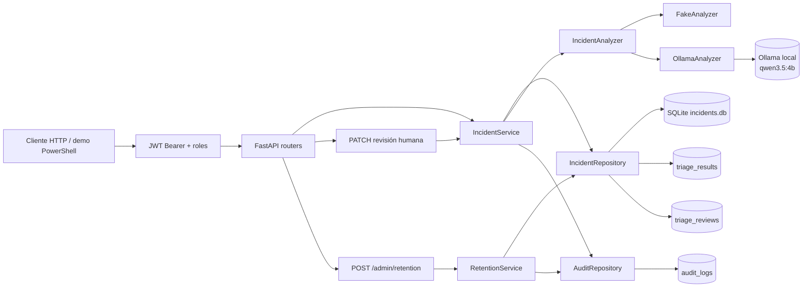

# Sistema inteligente de triaje de incidencias

API pequeña para registrar incidencias, generar una propuesta de triaje y permitir que una persona la acepte o la
corrija. El proyecto es un MVP demostrable: mantiene separadas la entrada, el análisis, la persistencia y la
revisión humana, y añade autenticación por API key, autorización por roles, auditoría y retención de datos. No
incluye todavía una UI, RAG ni agentes.

## Qué resuelve

1. Recibe una incidencia con contexto técnico.
2. La persiste en SQLite y la deja en estado `created`.
3. Ejecuta un analizador explícito con `POST /incidents/{id}/analysis`.
4. Guarda la propuesta estructurada (`category`, `severity`, `priority`, faltantes y confianza).
5. Permite aceptar o corregir la propuesta con `PATCH /incidents/{id}/triage`.
6. Conserva la propuesta original y almacena los valores finales revisados.
7. Protege la API con API keys y roles `reader`, `writer` y `admin`.
8. Registra las acciones relevantes en una auditoría consultable sin contenido sensible.
9. Purga incidencias y auditoría antiguas con dry-run, ejecución administrativa y traza del resultado.

Estados principales: `created → analyzing → analyzed → reviewed`. Si el análisis falla, el estado es
`analysis_failed`.

## Arquitectura



Capas:

- `backend/main.py`: creación de la aplicación y ciclo de vida; las rutas y dependencias están en `backend/api/`.
- `backend/api/routes.py`: controladores HTTP, validación mediante esquemas y traducción de errores a HTTP.
- `backend/api/dependencies.py`: composición de servicios, repositorios y analizadores para FastAPI.
- `backend/auth.py`: roles, almacén de API keys y dependencias de autenticación/autorización.
- `backend/services/incident.py`: transiciones de estado y casos de uso de incidencias.
- `backend/services/retention.py`: caso de uso de retención y CLI `python -m backend.services.retention`.
- `backend/infrastructure/repositories.py`: consultas y persistencia SQLAlchemy, incluida auditoría y retención.
- `backend/infrastructure/orm_models.py`: tablas `incidents`, `triage_results`, `triage_reviews` y `audit_logs`.
- `backend/infrastructure/config.py` y `backend/infrastructure/database.py`: configuración, engine, sesiones y creación de tablas.
- `backend/domain/models.py`: enums y estados del dominio.
- `backend/analyzers/core.py`: protocolo `IncidentAnalyzer`, `FakeAnalyzer` y adaptador `OllamaAnalyzer`.
- `backend/schemas.py`: contratos Pydantic públicos.
- `backend/evaluation/runner.py`: evaluación offline independiente de FastAPI.

La aplicación usa estas rutas por capas directamente; no se mantienen módulos fachada ni aliases de compatibilidad.

## Instalación y ejecución local

Requiere Python 3.11 o superior:

```powershell
python -m venv .venv
.\.venv\Scripts\Activate.ps1
python -m pip install -e ".[test]"
uvicorn backend.main:app --reload
```

La API queda en `http://127.0.0.1:8000`; la documentación OpenAPI está disponible en `/docs` y el health check
público en `/health`. SQLite usa por defecto una ruta absoluta en la raíz del proyecto (`incidents.db`) para no
depender del directorio desde el que se arranque Uvicorn. El backend de análisis por defecto es `fake`, por lo que
este arranque no necesita Ollama.

El frontend vive en `frontend/` y requiere Node 24 o superior:

```powershell
Set-Location frontend
npm install
npm run dev
```

La URL del backend se puede configurar con `VITE_API_URL`; si se omite durante `npm run dev`, Vite hace proxy
de las rutas de la API hacia `http://127.0.0.1:8000`. Para un frontend servido fuera de Vite, define
`VITE_API_URL` con el origen del backend (por ejemplo, `http://127.0.0.1:8000`, sin añadir `/api`).
La base incluye Vite + React + TypeScript, Tailwind, componentes compatibles con shadcn/ui, TanStack Query,
React Router, react-hook-form, zod, Vitest, Testing Library y MSW.

Rutas frontend disponibles: `/` (bandeja), `/new` (creación), `/incidents/:id` (detalle, análisis y revisión),
`/metrics` (métricas) y `/login` (autenticación). Las rutas de trabajo requieren un token JWT; una respuesta 401
limpia la sesión local y redirige al acceso.

Para comprobar la instalación:

```powershell
python -m pytest -q
```

La suite usa el backend determinista y no realiza llamadas a Ollama. Las validaciones completas son:

```powershell
python -m pytest -q
Set-Location frontend
npm ci
npm run lint
npm test -- --run
npm run build
```

CI ejecuta estas comprobaciones separando los jobs de backend y frontend, además de validar el Dockerfile.

## Configuración

| Variable | Default | Uso |
|---|---|---|
| `APP_NAME` | nombre del proyecto | Título de FastAPI. |
| `DATABASE_URL` | SQLite local absoluta | URL SQLAlchemy; no se crean migraciones en este MVP. |
| `ANALYZER_BACKEND` | `fake` | `fake` para desarrollo/tests o `ollama` explícito. |
| `OLLAMA_BASE_URL` | `http://127.0.0.1:11434` | Runtime local de Ollama. |
| `OLLAMA_MODEL` | `qwen3.5:4b` | Modelo Ollama. |
| `OLLAMA_TIMEOUT_SECONDS` | `180` | Timeout finito del adaptador. |
| `AUTH_USERS` | vacío | Usuarios y roles con formato `name:role:password,...`; vacío deshabilita auth local. |
| `JWT_SECRET` | vacío | Secreto HS256; mínimo 32 caracteres cuando `AUTH_USERS` está configurado. |
| `JWT_EXPIRATION_MINUTES` | `60` | Duración de los tokens JWT. |
| `CORS_ORIGINS` | `http://localhost:5173` | Orígenes HTTP(S) separados por comas; `*` no está permitido. |
| `RETENTION_DAYS` | `90` | Antigüedad mínima de incidencias antes de poder purgarlas. |
| `AUDIT_RETENTION_DAYS` | `365` | Antigüedad mínima de registros de auditoría antes de purgarlos. |

El arranque valida backend, URL HTTP(S), modelo no vacío, timeout positivo, días de retención positivos, el formato
de `AUTH_USERS`, la longitud de `JWT_SECRET` y los orígenes CORS. `GET /health` es público, no llama a Ollama ni
expone URL, modelo, usuarios, claves o secretos:

```json
{"status":"ok","analyzer_backend":"fake"}
```

## Autenticación y autorización

La autenticación se activa definiendo `AUTH_USERS` y `JWT_SECRET`. El formato es una lista separada por comas con
entradas `nombre:rol:contraseña`:

```powershell
$env:AUTH_USERS = "soporte:writer:contraseña-de-soporte,auditor:reader:contraseña-de-auditor,admin:admin:contraseña-de-admin"
$env:JWT_SECRET = "cambia-este-secreto-por-uno-de-al-menos-32-caracteres"
uvicorn backend.main:app --reload
```

- `POST /auth/login` recibe `{"username":"soporte","password":"..."}` y devuelve un token Bearer.
- Los roles son jerárquicos: `reader < writer < admin`.
- El cliente envía el token en la cabecera `Authorization: Bearer <token>`.
- Sin token o con un token inválido la API devuelve `401`; con un rol insuficiente devuelve `403`.
- `GET /health` permanece público para sondas de disponibilidad.
- Si `AUTH_USERS` está vacío, la autenticación se deshabilita y se permite todo el acceso. Es el modo por defecto
  para desarrollo local, tests y demo.
- Las contraseñas y secretos no se incluyen en respuestas, logs ni auditoría. Las comparaciones usan hashes y
  `secrets.compare_digest`.

| Rol | Permisos |
|---|---|
| `reader` | `GET /incidents/{id}` |
| `writer` | Todo lo de `reader` más `POST /incidents`, `POST /incidents/{id}/analysis` y `PATCH /incidents/{id}/triage` |
| `admin` | Todo lo anterior más `GET /audit` y `POST /admin/retention` |

```powershell
$login = curl.exe -sS -X POST http://127.0.0.1:8000/auth/login `
  -H "Content-Type: application/json" `
  --data-raw '{"username":"auditor","password":"contraseña-de-auditor"}' | ConvertFrom-Json
curl.exe -i http://127.0.0.1:8000/incidents/{incident_id} `
  -H "Authorization: Bearer $($login.access_token)"
```

## API y ejemplos

### Crear incidencia — `POST /incidents`

```powershell
$body = '{"title":"El panel no carga","description":"Devuelve un error al abrirlo.","steps_to_reproduce":"Abrir el panel.","environment":"local","components":["frontend"]}'
curl.exe -i -X POST http://127.0.0.1:8000/incidents `
  -H "Content-Type: application/json" --data-raw $body
```

Respuesta `201 Created`:

```json
{
  "title": "El panel no carga",
  "description": "Devuelve un error al abrirlo.",
  "steps_to_reproduce": "Abrir el panel.",
  "expected_behavior": null,
  "actual_behavior": null,
  "environment": "local",
  "components": ["frontend"],
  "id": "00000000-0000-0000-0000-000000000000",
  "status": "created",
  "created_at": "2026-10-29T12:00:00",
  "triage": null
}
```

### Consultar — `GET /incidents/{incident_id}`

```powershell
curl.exe -i http://127.0.0.1:8000/incidents/{incident_id}
```

Devuelve `200` si existe y `404` con `{"detail":"Incident not found"}` si no existe.

### Bandeja ligera — `GET /incidents`

```powershell
curl.exe -i "http://127.0.0.1:8000/incidents?limit=20&offset=0&status=analyzed&confidence=high"
```

Devuelve incidencias ordenadas por `created_at` descendente con `id`, `title`, `status`, `created_at`,
la `confidence` de la propuesta y los bloques ligeros `proposal` y `final` (este último solo si existe
una revisión). Admite `limit` (1–200), `offset`, `status` y `confidence`.

### Analizar — `POST /incidents/{incident_id}/analysis`

```powershell
curl.exe -i -X POST http://127.0.0.1:8000/incidents/{incident_id}/analysis
```

La respuesta `200` contiene `status: "analyzed"` y `triage` con:
`category` (`bug`, `feature`, `documentation`, `configuration`, `performance`), `severity`
(`low`, `medium`, `high`, `critical`), `priority` (`low`, `medium`, `high`, `urgent`), `summary`,
`affected_components`, `missing_information`, `justification` y `confidence` (`low`, `medium`, `high`).
Un segundo análisis devuelve `409`.

### Revisar — `PATCH /incidents/{incident_id}/triage`

```powershell
curl.exe -i -X PATCH http://127.0.0.1:8000/incidents/{incident_id}/triage `
  -H "Content-Type: application/json" `
  --data-raw '{"severity":"critical","priority":"urgent","review_comment":"Impacto confirmado"}'
```

La respuesta `200` cambia el estado a `reviewed`. `triage` sigue siendo la propuesta original y
`triage.review.final` contiene los valores finales, con `reviewed: true`, `source: "human"`, comentario y timestamp.
Un comentario solo acepta la propuesta sin cambios. Una petición vacía, una incidencia sin análisis o una revisión
duplicada devuelve `422`/`409` según el caso.

Límites relevantes: título 1–200 caracteres, descripción 1–5000, comentarios 2000, componentes y listas de triaje
máximo 20 elementos. Los campos desconocidos se rechazan. Si la autenticación está activa, añade la cabecera `Authorization: Bearer <token>` a todas las peticiones salvo
`GET /health`.

`affected_components` y `missing_information` se tratan como conjuntos: el orden de sus elementos no forma parte
del contrato y los duplicados se eliminan durante la validación. `summary` y `justification` se conservan como
texto exacto.

### Métricas de revisión — `GET /review-metrics`

```powershell
curl.exe -i http://127.0.0.1:8000/review-metrics
```

Devuelve el total de revisiones, aceptaciones sin cambios, acierto por campo, matrices de confusión para
`category`, `severity`, `priority` y `confidence`, y correcciones agrupadas por la confianza de la propuesta.

## Auditoría

Las acciones relevantes se guardan en la tabla `audit_logs` con actor, rol, acción, tipo e identificador del recurso
y metadatos operativos. No se guardan títulos, descripciones, comentarios, prompts ni claves.

| Acción | Cuándo se registra |
|---|---|
| `incident.create` | Se crea una incidencia. |
| `incident.analyze` | El análisis termina correctamente. |
| `incident.analysis_failed` | El análisis falla; incluye el tipo de error, no su mensaje. |
| `incident.review` | Se acepta o corrige el triaje; incluye campos cambiados y si hubo comentario. |
| `retention.run` | Se ejecuta un dry-run o una purga; incluye cortes y recuentos. |

`GET /audit` es solo para `admin` y admite `limit` (1–200, default 50), `offset`, `action`, `actor`,
`resource_type` y `resource_id`:

```powershell
curl.exe -i "http://127.0.0.1:8000/audit?action=incident.review&limit=20" `
  -H "Authorization: Bearer $($login.access_token)"
```

```json
{
  "items": [
    {
      "id": "00000000-0000-0000-0000-000000000000",
      "created_at": "2026-10-31T12:00:00+00:00",
      "actor": "soporte",
      "role": "writer",
      "action": "incident.review",
      "resource_type": "incident",
      "resource_id": "00000000-0000-0000-0000-000000000001",
      "details": {"status": "reviewed", "changed_fields": ["severity"], "has_comment": true}
    }
  ],
  "total": 1,
  "limit": 20,
  "offset": 0
}
```

## Retención de datos

La retención elimina datos antiguos por antigüedad, nunca por estado ni por contenido:

- `RETENTION_DAYS` define el corte de incidencias. Se borran primero sus `triage_reviews`, después sus
  `triage_results` y por último las incidencias. El cutoff se calcula con UTC.
- `AUDIT_RETENTION_DAYS` define el corte de `audit_logs`.
- Tanto la CLI como el endpoint hacen **dry-run por defecto**: calculan cuántas filas coinciden sin borrar nada.
- Cada ejecución, incluido el dry-run, se registra en auditoría como `retention.run`.

`POST /admin/retention` es solo para `admin` y acepta días alternativos para una ejecución concreta:

```powershell
curl.exe -i -X POST http://127.0.0.1:8000/admin/retention `
  -H "Authorization: Bearer $($login.access_token)" `
  -H "Content-Type: application/json" `
  --data-raw '{"dry_run":true,"incidents_days":90,"audit_days":365}'
```

```json
{
  "dry_run": true,
  "incident_cutoff": "2026-08-02T12:00:00+00:00",
  "audit_cutoff": "2025-10-31T12:00:00+00:00",
  "incidents_matched": 3,
  "triage_results_matched": 3,
  "triage_reviews_matched": 2,
  "audit_logs_matched": 10
}
```

Para ejecutarla fuera de la API:

```powershell
python -m backend.services.retention
python -m backend.services.retention --incidents-days 30 --audit-days 180
python -m backend.services.retention --apply
```

`*_matched` indica las filas seleccionadas por el corte; con `--apply` o `"dry_run": false` son las filas
eliminadas. La CLI imprime el resultado en JSON y usa el actor `retention-cli` con rol `admin`.

## FakeAnalyzer y Ollama

`FakeAnalyzer` es el backend por defecto: determinista, local y explicable. Normaliza mayúsculas y acentos, aplica
reglas con límites de palabra y puntúa señales de categoría, severidad y prioridad. También detecta conceptos que
faltan en el texto (latencia, porcentaje afectado, ventana temporal, correlación y observabilidad) cuando la
incidencia es ambigua. La justificación enumera las señales que han influido en la propuesta. Sigue siendo un
baseline de reglas, no una medida de calidad semántica de un LLM. Ollama es opcional:

```powershell
irm https://ollama.com/install.ps1 | iex
ollama serve
ollama pull qwen3.5:4b
ollama list
Invoke-RestMethod http://127.0.0.1:11434/api/tags
$env:ANALYZER_BACKEND = "ollama"
uvicorn backend.main:app --reload
```

`OllamaAnalyzer` solicita JSON estructurado con temperatura cero, `think: false` y `num_predict: 512`; valida la
respuesta contra `TriageResult`. Proveedor no disponible o respuesta inválida producen `502`; timeout produce `504`,
sin fallback silencioso ni trazas en la respuesta. Los tests nunca llaman a Ollama.

## Evaluación offline

Hay varios conjuntos con propósitos distintos:

- `eval/data/incidents.json`: 28 casos de desarrollo, usados para ajustar las reglas.
- `eval/data/incidents-holdout.json`: 12 casos del primer holdout. Se usó para detectar el fallo de credenciales, así
  que después de corregirlo ya no es una referencia ciega.
- `eval/data/incidents-regression.json`: 12 casos que encontraron falsos positivos durante esta iteración (“documento”
  interpretado como documentación, guías que mencionan configuración). Se conserva como regresión.
- `eval/data/incidents-holdout-v2.json`: 12 casos escritos después de los cambios y ejecutados una sola vez. Es la
  referencia más honesta de generalización de esta iteración.

```powershell
python -m backend.evaluation
python -m backend.evaluation --dataset eval/data/incidents-holdout-v2.json
python -m backend.evaluation --dataset eval/data/incidents-regression.json
python -m backend.evaluation --dataset eval/data/incidents-holdout.json
python -m backend.evaluation --verbose
python -m backend.evaluation --summary
python -m backend.evaluation --summary --dataset eval/data/incidents-holdout-v2.json
python -m backend.evaluation --backend fake --compare-with ollama --summary
```

`--verbose` imprime en `stderr` el resultado por caso y los campos que no coinciden. `--summary` imprime en `stderr` un
resumen legible (accuracy, macro-F1, calibración de confianza, errores por categoría esperada y principales
confusiones). En ambos casos el JSON de métricas permanece en `stdout` para poder redirigirlo. La salida se fuerza a
UTF-8. Si redirigues desde PowerShell y aparecen acentos corruptos, ejecuta antes
`[Console]::OutputEncoding = [Text.UTF8Encoding]::new()` (y lo mismo para `$OutputEncoding`); en pantalla no hace falta.
Las métricas de calidad son reproducibles; solo varía la latencia. Una ejecución reciente del baseline `FakeAnalyzer`
produce:

| Conjunto | Casos | Category | Severity | Priority | Missing info | Confidence | Errores |
|---|---:|---:|---:|---:|---:|---:|---:|
| Desarrollo (ajuste) | 28 | 1.000 | 1.000 | 1.000 | 1.000 | 0.893 | 0 |
| Holdout original (ya no ciego) | 12 | 1.000 | 1.000 | 1.000 | 1.000 | 1.000 | 0 |
| Regresión | 12 | 1.000 | 0.917 | 1.000 | 1.000 | 1.000 | 0 |
| Holdout v2 (ciego) | 12 | 1.000 | 0.917 | 0.917 | 1.000 | 0.917 | 0 |

Además de la accuracy, el JSON incluye:

- `category_macro_f1`, `severity_macro_f1` y `priority_macro_f1`.
- `per_class`: precisión, recall, F1 y soporte por clase.
- `confusion_matrix`: matriz esperado × predicho por campo.
- `missing_information_precision`, `missing_information_recall` y `missing_information_f1` en micro.
- `latency_ms_p50` y `latency_ms_p95`.
- `confidence_calibration`: para cada nivel (`low`, `medium`, `high`), número de casos, casos totalmente correctos y
  accuracy. Sirve para comprobar si la confianza declarada se corresponde con los aciertos reales.
- `errors_by_category`: número de fallos agrupados por la categoría esperada, para localizar qué clases concentran el
  error.

`--compare-with` ejecuta dos backends sobre el mismo conjunto y compara resultados. El backend de `--backend` es la
referencia y `--compare-with` el candidato; deben ser distintos. Imprime mejoras, empeoramientos, cambios entre fallos
y deltas de accuracy, macro-F1, latencia y errores. En este modo el JSON cambia de forma: incluye `baseline.metrics`,
`candidate.metrics`, `deltas` y `cases` (con `cases.detail` por caso: esperado, resultado y fallos de cada backend). Es
la forma reproducible de responder si Ollama mejora al baseline:

```powershell
python -m backend.evaluation --backend fake --compare-with ollama --summary
```

Ese comando sí necesita Ollama levantado; los tests siguen sin llamar al LLM.

En el holdout v2, la categoría acierta 12/12 y los dos fallos son ilustrativos: “no está disponible” no activa la
criticidad porque la regla solo reconoce “no disponible”, y un bug sin señal léxica clara queda en confianza `low`
frente a `medium`. No se ajustaron las reglas después de ver ese resultado. En desarrollo, la confianza `medium` acierta
2/2 y `high` 23/26; los tres desacuerdos son casos etiquetados como `medium` que el motor considera `high`.

Un acierto de enum exige igualdad exacta. `missing_information` se sigue comparando como lista exacta para la
accuracy, pero las métricas de precisión/recall/F1 permiten distinguir entre olvidar un concepto y añadir uno de más.
`summary` y `justification` no se puntúan por similitud de texto libre.

El 1.000 de desarrollo es optimista porque esas reglas se ajustaron con ese conjunto. Los holdouts tienen 12 casos: un
solo fallo mueve la accuracy unos 8 puntos, así que los resultados deben leerse como una señal de robustez del
baseline, no como una estimación precisa. Para Ollama, con el runtime ya disponible:

```powershell
python -m backend.evaluation --backend ollama
```

### Comparación real `fake` frente a `ollama`

Ejecutada el 30 de octubre de 2026 sobre `eval/data/incidents-holdout-v2.json` (12 casos), con:

- Modelo `qwen3.5:4b` (Q4_K_M, 4.2B) servido por Ollama en local.
- Equipo de desarrollo: Intel Core i7-1255U, 32 GB de RAM, gráficos Intel Iris Xe. La latencia depende del hardware.
- Comando:
  `python -m backend.evaluation --backend fake --compare-with ollama --dataset eval/data/incidents-holdout-v2.json --summary`
- Artefactos: `eval/results/ollama-vs-fake-holdout-v2.json` (detalle por caso) y
  `eval/results/ollama-vs-fake-holdout-v2.txt` (resumen).

| Backend | Category | Severity | Priority | Missing info | Confidence | Macro-F1 cat / sev / prio | p50 | p95 | Errores | Casos completos |
|---|---:|---:|---:|---:|---:|---|---:|---:|---:|---:|
| `fake` | 1.000 | 0.917 | 0.917 | 1.000 | 0.917 | 1.000 / 0.889 / 0.914 | 0.14 ms | 1.23 ms | 0 | 10/12 |
| `ollama` | 0.833 | 0.583 | 0.417 | 0.083 | 0.167 | 0.853 / 0.586 / 0.250 | 19 167.57 ms | 21 738.72 ms | 0 | 0/12 |

Deltas de Ollama respecto al fake: category `-0.167`, severity `-0.333`, priority `-0.500`, missing `-0.917`,
confidence `-0.750`; macro-F1 `-0.147 / -0.303 / -0.664`; p50 `+19 167.43 ms`; p95 `+21 737.49 ms`. De los 12 casos,
Ollama no mejora ninguno, empeora 10 y cambia otros 2 sin llegar a acertarlos completos. Dos ejecuciones consecutivas
dieron las mismas métricas de calidad; la latencia p50 varió entre 19.2 s y 22.4 s.

| Caso | Esperado (cat / sev / prio) | Ollama (cat / sev / prio) | Fallos |
|---|---|---|---|
| `invoice-download-permission` | bug / critical / urgent | bug / high / high | sev, prio, missing, conf |
| `form-values-not-persisted` | bug / high / high | bug / high / high | missing, conf |
| `filter-dropdown-missing` | bug / medium / medium | bug / medium / medium | missing, conf |
| `report-export-timeout` | performance / high / high | performance / high / high | missing, conf |
| `database-url-missing` | configuration / medium / high | configuration / critical / high | sev |
| `cors-header-not-configured` | configuration / medium / high | bug / high / high | cat, sev, missing, conf |
| `dark-theme-request` | feature / low / low | feature / low / medium | prio, missing, conf |
| `changelog-guide-outdated` | documentation / low / medium | documentation / medium / low | sev, prio, missing, conf |
| `delete-account-request` | feature / low / low | feature / low / medium | prio, missing, conf |
| `api-502-after-deploy` | bug / high / urgent | performance / critical / high | cat, sev, prio, missing, conf |
| `memory-growth-after-update` | performance / critical / urgent | performance / critical / high | prio, missing, conf |
| `search-results-outdated` | bug / medium / medium | bug / medium / high | prio, missing |

El patrón dominante no parece ser un problema de comprensión: Ollama acierta la categoría en 10 de 12 casos, pero no
sigue el contrato campo a campo:

- **`missing_information`:** añade datos faltantes en 11 de 12 casos. En `filter-dropdown-missing` llega a devolver una
  lista con `"Ninguna información faltante identificada en el reporte proporcionado."` en vez de `[]`. El prompt actual
  no define cuándo la lista debe quedar vacía ni limita su contenido a datos imprescindibles.
- **Confianza:** devuelve `medium` en 11 casos y `high` en 1, mientras que el esperado es `high` en 11 y `medium` en 1.
  Acierta el nivel en 2 de 12, pero ningún caso queda completamente correcto. La confianza no está calibrada contra el
  contrato.
- **Prioridad y severidad:** tiende a valores intermedios. Rebaja urgencias (`invoice`, `api-502` y `memory` pasan de
  `urgent` a `high`), sube peticiones `low` a `medium` (`dark-theme`, `delete-account`) y baja documentación `medium` a
  `low` (`changelog`). En severidad acierta 7 de 12.
- **Categoría:** es el campo que mejor resuelve (10 de 12). Falla donde los conceptos se solapan:
  `cors-header-not-configured` pasa de `configuration` a `bug` y `api-502-after-deploy` de `bug` a `performance`.
- **Latencia:** unos 19 s por caso en mediana y 22 s en p95, frente a 0.14 ms y 1.23 ms del fake. Es un coste relevante
  incluso si la calidad fuera equivalente.

La lectura honesta es que el adaptador actual de Ollama no compite con el baseline en este conjunto. No se cambió el
prompt ni las reglas después de ver estos resultados: hacerlo sobre el holdout v2 lo convertiría en un conjunto de
ajuste. El siguiente paso razonable es definir una rúbrica explícita (categorías, política de severidad/prioridad,
cuándo `missing_information` va vacío y cómo calibrar `confidence`), añadir ejemplos y validarla sobre un holdout nuevo
o con validación cruzada. Solo tendría sentido promover Ollama a backend por defecto si supera al fake con un coste de
latencia aceptable.

Limitaciones de esta comparación: 12 casos (un fallo mueve la accuracy unos 8 puntos), un único modelo y cuantización,
un único equipo, sin intervalos de confianza y con un prompt mínimo sin rúbrica ni ejemplos. El 10/12 del fake tampoco
es una estimación neutral: sus reglas se ajustaron con otros conjuntos. Los resultados describen este adaptador y este
conjunto, no el techo del modelo.

Para regenerar los artefactos:

```powershell
[Console]::OutputEncoding = [Text.UTF8Encoding]::new()
$OutputEncoding = [Text.UTF8Encoding]::new()
python -m backend.evaluation --backend fake --compare-with ollama `
  --dataset eval/data/incidents-holdout-v2.json --summary `
  2> eval/results/ollama-vs-fake-holdout-v2.txt `
  > eval/results/ollama-vs-fake-holdout-v2.json
```

## Demo reproducible

Con la API arrancada en otra terminal:

```powershell
.\scripts\demo.ps1
```

El script ejecuta health → create → analysis → GET → review, no contiene secretos y solo usa `curl.exe` y herramientas
incluidas en PowerShell. También acepta una URL alternativa y credenciales JWT opcionales:

```powershell
.\scripts\demo.ps1 -BaseUrl "http://localhost:8000"
.\scripts\demo.ps1 -Username "soporte" -Password $env:WRITER_PASSWORD
```

El token solo se usa para construir la cabecera `Authorization`; no se imprime ni se escribe en disco. Con la
autenticación deshabilitada (`AUTH_USERS` vacío) el script funciona sin credenciales.

## Docker y CI

```powershell
docker build -t triaje-api .
docker run --rm -p 8000:8000 -v "${PWD}/data:/data" `
  -e DATABASE_URL=sqlite:////data/incidents.db triaje-api
```

La imagen no incluye `incidents.db`, tests, `.venv`, artefactos locales ni secretos. El contenedor no inicia Ollama:
debe ejecutarse aparte. GitHub Actions en `.github/workflows/ci.yml` instala el proyecto, ejecuta pytest, instala
el frontend con `npm ci`, ejecuta type-check, tests y build, y valida el Dockerfile. Si activas la autenticación,
inyecta `AUTH_USERS` y `JWT_SECRET` con `--env-file` o un gestor de secretos; no la incluyas en la imagen.
PostgreSQL no se incorpora todavía: SQLite cubre el MVP local y evita añadir operación,
driver y migraciones antes de necesitar despliegue multiinstancia.

## Decisiones, costes y seguridad

- **SQLite frente a PostgreSQL:** SQLite reduce fricción para el MVP; PostgreSQL será razonable cuando haya
  concurrencia, despliegue multiinstancia o necesidad de operaciones gestionadas.
- **Ollama frente a carga directa Python:** Ollama aísla runtime/modelo, hardware y ciclo de vida; cargar
  `transformers`/`torch` dentro de FastAPI añadiría peso y complejidad innecesarios.
- **FakeAnalyzer:** permite tests rápidos y reproducibles sin descargar modelos.
- **Sin RAG/agentes:** no son necesarios para clasificar el contrato actual y aumentarían superficie y coste.
- **Validación estructurada:** Pydantic rechaza respuestas incompletas; se evita puntuar o persistir texto no validado.
- **Revisión humana:** la tabla `triage_reviews` conserva el original y permite medir correcciones futuras.
- **Autenticación y autorización:** `AUTH_USERS` y `JWT_SECRET` se validan al arrancar; las contraseñas se comparan
  por hash y nunca se devuelven, registran ni auditan. Los tokens JWT tienen expiración configurable, los roles son
  jerárquicos y las rutas administrativas quedan restringidas a `admin`. Vaciar `AUTH_USERS` deshabilita auth solo
  para desarrollo local.
- **Auditoría:** `audit_logs` registra actor, rol, acción, recurso y metadatos operativos. Se evita guardar texto
  libre de incidencias, comentarios, prompts o claves. Si la escritura de auditoría falla durante un análisis, el
  error original se conserva y el fallo de auditoría se registra en el log.
- **Retención:** los cortes se calculan en UTC, la purga es explícita, auditable y hace dry-run por defecto; no se
  borra por estado ni por contenido. La API y la CLI comparten el mismo servicio.
- **Coste:** FakeAnalyzer + SQLite no requieren servicios externos; Ollama consume CPU/GPU, memoria, almacenamiento y
  tiempo local; se evitan costes de API externa en el MVP. El coste real depende del hardware y del modelo.
- **Seguridad:** no hay credenciales en el código; health y errores no exponen secretos; valida límites y configuración;
  usa una red local controlada para Ollama y no envíes datos sensibles sin una política de privacidad.

## Cómo explicarlo en entrevista

> “Separé el caso de uso de análisis del proveedor mediante `IncidentAnalyzer`: el fake es un baseline determinista
> con normalización, reglas explicables y señales de impacto; Ollama es un adaptador opcional. La propuesta se persiste
> separada de la revisión humana, así puedo auditar qué sugirió el sistema y qué cambió la persona. Medí accuracy,
> macro-F1, precisión/recall de faltantes, matrices de confusión, calibración de confianza y percentiles de latencia en
> desarrollo, un holdout original, un conjunto de regresión y un holdout ciego escrito después de los cambios; además
> puedo comparar fake frente a Ollama con deltas por caso, métrica y latencia. Sé que el fake no mide calidad de LLM y
> que 12 casos son una muestra pequeña. Elegí SQLite para reducir el coste operativo del MVP, añadí límites, errores
> explícitos, logs JSON sin contenido sensible, API keys con roles jerárquicos, auditoría sin datos sensibles,
> retención con dry-run y CI/Docker para que la demo sea reproducible.”

## Limitaciones y mejoras futuras

- La evaluación usa conjuntos pequeños y etiquetados manualmente: ampliar casos, revisar el acuerdo entre
  etiquetadores y validar en un holdout nuevo antes de interpretar las métricas como calidad de producción.
- El `FakeAnalyzer` es un motor de reglas determinista, no comprensión semántica. Todavía puede fallar con
  formulaciones literales o ambiguas y su confianza no está calibrada con suficiente volumen; el benchmark de Ollama
  incluido tampoco justifica usarlo como backend por defecto.
- `missing_information` se evalúa con listas exactas además de micro-F1. Con pocos casos positivos, una métrica alta no
  garantiza que las preguntas sugeridas sean útiles en incidencias reales.
- La persistencia usa SQLite y `create_all`: para un despliegue multiinstancia harán falta PostgreSQL, migraciones,
  copias de seguridad y una estrategia de operación que no forma parte de este MVP.
- La autenticación es estática mediante API keys en variables de entorno. Faltan rotación, caducidad, gestión por
  usuario, rate limiting y terminación TLS en un proxy; las claves deben provisionarse fuera del repositorio.
- La auditoría comparte la misma base de datos que la aplicación y no es un sumidero inmutable externo. Si SQLite no
  está disponible, tampoco lo está la auditoría.
- La retención hace borrado físico y no gestiona copias de seguridad, bloqueos legales ni periodos de gracia; su
  ejecución periódica debe programarse fuera de la API (cron, Task Scheduler o similar).
- Añadir una UI para consulta y revisión humana enriquecida sigue siendo una mejora futura válida después de estabilizar
  el contrato API.
