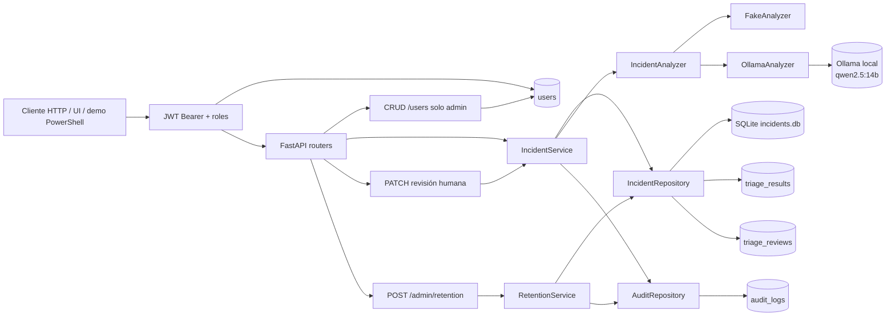

# Sistema inteligente de triaje de incidencias

API y frontend para registrar incidencias, generar una propuesta de triaje y permitir que una persona la acepte o la
corrija. El proyecto es un MVP demostrable: mantiene separadas la entrada, el análisis, la persistencia y la
revisión humana, y añade autenticación con usuarios persistidos y contraseñas Argon2id, JWT versionados, autorización
por roles, gestión administrativa de usuarios, auditoría y retención de datos. No incluye todavía RAG ni agentes.

## Qué resuelve

1. Recibe una incidencia con contexto técnico.
2. La persiste en SQLite y la deja en estado `created`.
3. Ejecuta un analizador explícito con `POST /incidents/{id}/analysis`.
4. Guarda la propuesta estructurada (`category`, `severity`, `priority`, faltantes y confianza).
5. Permite aceptar o corregir la propuesta con `PATCH /incidents/{id}/triage`, dejando checklist y comentario.
6. Conserva la propuesta original y almacena los valores finales revisados.
7. Protege la API con JWT y roles `reader`, `writer` y `admin`; la UI oculta las acciones no permitidas.
8. Gestiona usuarios y roles desde la API y la UI, con guardas para no quedarse sin administradores.
9. Registra las acciones relevantes en una auditoría consultable sin contenido sensible.
10. Purga incidencias y auditoría antiguas con dry-run, ejecución administrativa y traza del resultado.

Estados principales: `created → analyzing → analyzed → reviewed`. Si el análisis falla, el estado es
`analysis_failed`.

## Arquitectura



Capas:

- `backend/main.py`: creación de la aplicación y ciclo de vida; las rutas y dependencias están en `backend/api/`.
- `backend/api/routes.py`: controladores HTTP, validación mediante esquemas y traducción de errores a HTTP.
- `backend/api/dependencies.py`: composición de servicios, repositorios y analizadores para FastAPI.
- `backend/auth.py`: roles, Argon2id, emisión/validación de JWT y dependencias de autenticación/autorización.
- `backend/services/incident.py`: transiciones de estado y casos de uso de incidencias.
- `backend/services/users.py`: bootstrap, login, CRUD de usuarios y guardas del último administrador.
- `backend/services/retention.py`: caso de uso de retención y CLI `python -m backend.services.retention`.
- `backend/infrastructure/repositories.py`: consultas y persistencia SQLAlchemy, incluida auditoría, usuarios y retención.
- `backend/infrastructure/orm_models.py`: tablas `users`, `incidents`, `triage_results`, `triage_reviews` y `audit_logs`.
- `backend/infrastructure/config.py` y `backend/infrastructure/database.py`: configuración, engine, sesiones, creación de tablas y migración aditiva ligera.
- `backend/domain/models.py`: enums y estados del dominio.
- `backend/analyzers/core.py`: protocolo `IncidentAnalyzer`, `FakeAnalyzer` y adaptador `OllamaAnalyzer`.
- `backend/schemas.py`: contratos Pydantic públicos.
- `evaluation/runner.py`: evaluación offline independiente de FastAPI.

La aplicación usa estas rutas por capas directamente; no se mantienen módulos fachada ni aliases de compatibilidad.

## Instalación y ejecución local

Requiere Python 3.11 o superior:

```powershell
python -m venv .venv
.\.venv\Scripts\Activate.ps1
python -m pip install -e ".[test]"
uvicorn backend.main:app --reload
```

La API queda en `http://127.0.0.1:8000`; la documentación OpenAPI está disponible en `/docs` y el health check
público en `/health`. SQLite usa por defecto una ruta absoluta en la raíz del proyecto (`incidents.db`) para no
depender del directorio desde el que se arranque Uvicorn. El backend de análisis por defecto es `fake`, por lo que
este arranque no necesita Ollama.

El frontend vive en `frontend/` y requiere Node 24 o superior:

```powershell
Set-Location frontend
npm install
npm run dev
```

El frontend usa `VITE_API_URL` como origen del backend y, si no se define, apunta a `http://127.0.0.1:8000` (sin
añadir `/api`). El servidor de desarrollo de Vite mantiene proxies para las rutas de la API, útiles si prefieres
servirlas por el mismo origen. La base incluye Vite + React + TypeScript, Tailwind, componentes compatibles con
shadcn/ui, TanStack Query, React Router, react-hook-form, zod, Vitest, Testing Library, MSW, ESLint y Prettier.
El código se organiza por `features/` (`incidents`, `review`, `metrics`) y `shared/` (componentes y utilidades
reutilizables); `src/api` sigue siendo el cliente tipado único.

Rutas frontend disponibles: `/` (bandeja con filtros por estado y confianza, vista de pendientes priorizada por
confianza baja y paginación), `/new` (creación con chips de componentes y errores 422 por campo), `/incidents/:id`
(detalle, análisis, aviso de confianza baja y de Ollama, diff IA→humano y revisión con checklist de faltantes),
`/metrics` (métricas con matriz de confusión y aviso de fiabilidad), `/users` (gestión de usuarios, solo admin) y
`/login` (autenticación). La UI conoce el rol: `reader` no ve acciones de escritura y solo `admin` ve Usuarios. Una
respuesta 401 limpia la sesión local y redirige al acceso; si el backend informa `authenticated: false`, la app
funciona en modo anónimo.

Para comprobar la instalación:

```powershell
python -m pytest -q
```

La suite usa el backend determinista y no realiza llamadas a Ollama. Estado actual: **140 tests backend** y
**34 tests frontend** (7 archivos). Las validaciones completas son:

```powershell
python -m pytest -q
Set-Location frontend
npm ci
npm run lint
npm run format:check
npm test -- --run
npm run build
```

CI ejecuta estas comprobaciones separando los jobs de backend y frontend (lint, formato, tests y build), además de
validar el Dockerfile.

## Configuración

| Variable | Default | Uso |
|---|---|---|
| `APP_NAME` | nombre del proyecto | Título de FastAPI. |
| `DATABASE_URL` | SQLite local absoluta | URL SQLAlchemy; el MVP usa `create_all` más una migración aditiva ligera para columnas nuevas. |
| `ANALYZER_BACKEND` | `fake` | `fake` para desarrollo/tests o `ollama` explícito. |
| `OLLAMA_BASE_URL` | `http://127.0.0.1:11434` | Runtime local de Ollama. |
| `OLLAMA_MODEL` | `qwen2.5:14b` | Modelo Ollama (por ejemplo `qwen2.5:14b`, `qwen2.5:7b` o `qwen2.5:3b`). |
| `OLLAMA_TIMEOUT_SECONDS` | `180` | Timeout finito del adaptador. |
| `AUTH_USERS` | vacío | Semilla inicial `name:role:password,...` para la tabla `users`. Solo crea usuarios que falten; después la BD manda. Vacío no siembra nada. |
| `JWT_SECRET` | vacío | Secreto HS256; mínimo 32 caracteres para emitir y validar tokens. |
| `JWT_EXPIRATION_MINUTES` | `15` | Duración del access token (por defecto 15 minutos). |
| `REFRESH_TOKEN_EXPIRATION_DAYS` | `7` | Duración del refresh token de larga duración (por defecto 7 días). |
| `CORS_ORIGINS` | `http://localhost:5173` | Orígenes HTTP(S) separados por comas; `*` no está permitido. |
| `RETENTION_DAYS` | `90` | Antigüedad mínima de incidencias antes de poder purgarlas. |
| `AUDIT_RETENTION_DAYS` | `365` | Antigüedad mínima de registros de auditoría antes de purgarlos. |

La configuración puede definirse mediante variables de entorno o a través de un archivo `.env` en la raíz del
proyecto (se proporciona una plantilla en `.env.example`).

El arranque valida backend, URL HTTP(S), modelo no vacío, timeout positivo, días de retención positivos, el formato
de `AUTH_USERS`, la longitud de `JWT_SECRET` y los orígenes CORS. Si `AUTH_USERS` está configurado, la autenticación
se exige aunque la tabla `users` esté vacía (fail-closed): no se degrada a modo anónimo por un fallo de bootstrap.
`GET /health` es público, no llama a Ollama ni expone URL, modelo, usuarios, claves o secretos:

```json
{"status":"ok","analyzer_backend":"fake"}
```

## Autenticación y autorización

La fuente de verdad es la tabla `users`: usuario, rol, `active`, hash Argon2id y versión de token. `AUTH_USERS` solo
siembra usuarios que aún no existan al arrancar; no actualiza contraseñas, roles ni reactiva cuentas. Una vez creada
la tabla, los cambios se hacen con el CRUD administrativo o directamente en base de datos.

```powershell
$env:AUTH_USERS = "soporte:writer:contraseña-de-soporte,auditor:reader:contraseña-de-auditor,admin:admin:contraseña-de-admin"
$env:JWT_SECRET = "cambia-este-secreto-por-uno-de-al-menos-32-caracteres"
uvicorn backend.main:app --reload
```

- `POST /auth/login` recibe `{"username":"soporte","password":"..."}` y devuelve el par de tokens (`access_token` de 15 min y `refresh_token` de 7 días con rotación) más el usuario.
- `POST /auth/refresh` recibe `{"refresh_token":"..."}`, valida la sesión en BD y emite un nuevo par de tokens (`access_token` renovado y `refresh_token` rotado).
- `GET /auth/me` devuelve `name`, `role` y `authenticated`. La UI lo usa para decidir qué acciones mostrar.
- `POST /auth/logout` revoca los tokens del usuario autenticado y responde `204`. La UI lo llama al pulsar **Salir** y,
  pase lo que pase, borra después los tokens locales.
- Las contraseñas se guardan con **Argon2id** y salt único; nunca se devuelven, registran ni auditan.
- El JWT de acceso incluye `sub`, `role`, `ver`, `typ: "access"`, `iat` y `exp`. `ver` es la versión de token del usuario.
- El refresh token incluye `sub`, `ver`, `typ: "refresh"`, `iat` y `exp` (no se puede usar directamente como token de autorización Bearer en endpoints de negocio).
- Cambiar la contraseña incrementa `token_version`: tanto el access token como el refresh token dejan de valer de inmediato.
- El logout también incrementa `token_version`, de modo que invalida **todos** los JWT y refresh tokens abiertos de ese usuario, no solo el token usado para cerrar sesión. Es una decisión consciente para que un token robado no siga vivo hasta su `exp`.
- Desactivar un usuario o cambiar su rol también se refleja de inmediato: cada petición y cada refresco revalida contra la BD.
- La UI implementa interceptores transparentes: cuando el `access_token` expira durante el uso de la aplicación, solicita automáticamente un nuevo par mediante `POST /auth/refresh` sin interrumpir al usuario; si el `refresh_token` también expiró o fue revocado, limpia el almacenamiento y redirige a `/login`.
- Los roles son jerárquicos: `reader < writer < admin`.
- Sin token o con token inválido la API devuelve `401`; con rol insuficiente, `403`.
- `GET /health` permanece público para sondas de disponibilidad.
- Si `AUTH_USERS` está vacío y la tabla `users` no tiene filas, la autenticación se deshabilita y se permite todo el
  acceso. Es el modo por defecto para desarrollo local, tests y demo. Si `AUTH_USERS` está configurado, la auth se
  exige aunque la tabla esté vacía (fail-closed).

| Rol | Permisos |
|---|---|
| `reader` | `GET /incidents`, `GET /incidents/{id}`, `GET /review-metrics`, `GET /auth/me` y `POST /auth/logout` |
| `writer` | Todo lo de `reader` más `POST /incidents`, `POST /incidents/{id}/analysis` y `PATCH /incidents/{id}/triage` |
| `admin` | Todo lo anterior más `GET /audit`, `POST /admin/retention` y el CRUD de `/users` |

```powershell
$login = curl.exe -sS -X POST http://127.0.0.1:8000/auth/login `
  -H "Content-Type: application/json" `
  --data-raw '{"username":"auditor","password":"contraseña-de-auditor"}' | ConvertFrom-Json
curl.exe -i http://127.0.0.1:8000/incidents/{incident_id} `
  -H "Authorization: Bearer $($login.access_token)"
curl.exe -i http://127.0.0.1:8000/auth/me `
  -H "Authorization: Bearer $($login.access_token)"
curl.exe -i -X POST http://127.0.0.1:8000/auth/logout `
  -H "Authorization: Bearer $($login.access_token)"
```

Guardas del CRUD de usuarios:

- Solo `admin` puede listar, crear, consultar, actualizar o desactivar usuarios.
- No se puede desactivar el último administrador activo ni degradar su rol.
- Un administrador no puede desactivar su propio usuario.
- El borrado es lógico (`DELETE` desactiva), para conservar la trazabilidad de la auditoría.
- Los nombres admiten `A-Z`, `a-z`, `0-9`, `.`, `_` y `-`; las contraseñas tienen entre 12 y 200 caracteres.

## API y ejemplos

### Crear incidencia — `POST /incidents`

```powershell
$body = '{"title":"El panel no carga","description":"Devuelve un error al abrirlo.","steps_to_reproduce":"Abrir el panel.","environment":"local","components":["frontend"]}'
curl.exe -i -X POST http://127.0.0.1:8000/incidents `
  -H "Content-Type: application/json" --data-raw $body
```

Respuesta `201 Created`:

```json
{
  "title": "El panel no carga",
  "description": "Devuelve un error al abrirlo.",
  "steps_to_reproduce": "Abrir el panel.",
  "expected_behavior": null,
  "actual_behavior": null,
  "environment": "local",
  "components": ["frontend"],
  "id": "00000000-0000-0000-0000-000000000000",
  "status": "created",
  "created_at": "2026-10-29T12:00:00",
  "triage": null
}
```

### Consultar — `GET /incidents/{incident_id}`

```powershell
curl.exe -i http://127.0.0.1:8000/incidents/{incident_id}
```

Devuelve `200` si existe y `404` con `{"detail":"Incident not found"}` si no existe.

### Bandeja ligera — `GET /incidents`

```powershell
curl.exe -i "http://127.0.0.1:8000/incidents?limit=20&offset=0&status=analyzed&confidence=high"
```

Devuelve incidencias ordenadas por `created_at` descendente con `id`, `title`, `status`, `created_at`,
la `confidence` de la propuesta y los bloques ligeros `proposal` y `final` (este último solo si existe
una revisión). Admite `limit` (1–200), `offset`, `status`, `confidence` y `sort`. Con `sort=confidence`
ordena de confianza baja a alta (los `null` al final y, dentro de cada grupo, por fecha descendente), lo que
permite construir la vista de pendientes priorizando lo que más necesita revisión humana.

### Analizar — `POST /incidents/{incident_id}/analysis`

```powershell
curl.exe -i -X POST http://127.0.0.1:8000/incidents/{incident_id}/analysis
```

La respuesta `200` contiene `status: "analyzed"` y `triage` con:
`category` (`bug`, `feature`, `documentation`, `configuration`, `performance`), `severity`
(`low`, `medium`, `high`, `critical`), `priority` (`low`, `medium`, `high`, `urgent`), `summary`,
`affected_components`, `missing_information`, `justification` y `confidence` (`low`, `medium`, `high`).
Un segundo análisis desde `analyzed` devuelve `409`; si el estado es `analysis_failed`, se permite reintentar.

### Revisar — `PATCH /incidents/{incident_id}/triage`

```powershell
curl.exe -i -X PATCH http://127.0.0.1:8000/incidents/{incident_id}/triage `
  -H "Content-Type: application/json" `
  --data-raw '{"severity":"critical","priority":"urgent","review_comment":"Impacto confirmado","review_checklist":["Revisé severidad y prioridad"]}'
```

La respuesta `200` cambia el estado a `reviewed`. `triage` sigue siendo la propuesta original y
`triage.review.final` contiene los valores finales, con `reviewed: true`, `source: "human"`, comentario,
`review_checklist`, timestamp y los campos corregidos. Un comentario solo acepta la propuesta sin cambios. Una
petición vacía, una incidencia sin análisis o una revisión duplicada devuelve `422`/`409` según el caso. La checklist
acepta hasta 20 elementos de 1–200 caracteres y se persiste en `triage_reviews.review_checklist`.

Límites relevantes: título 1–200 caracteres, descripción 1–5000, comentarios 2000, componentes y listas de triaje
máximo 20 elementos. Los campos desconocidos se rechazan. Si la autenticación está activa, añade la cabecera `Authorization: Bearer <token>` a todas las peticiones salvo
`GET /health`.

`affected_components` y `missing_information` se tratan como conjuntos: el orden de sus elementos no forma parte
del contrato y los duplicados se eliminan durante la validación. `summary` y `justification` se conservan como
texto exacto.

### Usuarios — `GET/POST/PATCH/DELETE /users`

Solo `admin`. Listado paginado en `GET /users?limit=50&offset=0`; creación con `POST /users`; consulta y
actualización con `GET/PATCH /users/{user_id}`; desactivación con `DELETE /users/{user_id}`.

```powershell
curl.exe -i -X POST http://127.0.0.1:8000/users `
  -H "Content-Type: application/json" `
  -H "Authorization: Bearer $($login.access_token)" `
  --data-raw '{"username":"nuevo.soporte","password":"contraseña-inicial-0123456789","role":"writer"}'
```

La respuesta nunca incluye `password_hash`. `PATCH` acepta `password`, `role` y `active`; debe cambiar al menos un
campo. `DELETE` desactiva al usuario en lugar de borrarlo. Los intentos de dejar el sistema sin administrador activo
devuelven `409`.

### Métricas de revisión — `GET /review-metrics`

```powershell
curl.exe -i http://127.0.0.1:8000/review-metrics
```

Devuelve el total de revisiones, aceptaciones sin cambios, acierto por campo, matrices de confusión para
`category`, `severity`, `priority` y `confidence`, y correcciones agrupadas por la confianza de la propuesta.

## Auditoría

Las acciones relevantes se guardan en la tabla `audit_logs` con actor, rol, acción, tipo e identificador del recurso
y metadatos operativos. No se guardan títulos, descripciones, comentarios, prompts ni claves.

| Acción | Cuándo se registra |
|---|---|
| `incident.create` | Se crea una incidencia. |
| `incident.analyze` | El análisis termina correctamente. |
| `incident.analysis_failed` | El análisis falla; incluye el tipo de error, no su mensaje. |
| `incident.review` | Se acepta o corrige el triaje; incluye campos realmente cambiados, si hubo comentario y nº de ítems de checklist. |
| `user.bootstrap` | Se siembran usuarios iniciales desde `AUTH_USERS`; incluye cuántos y con qué roles. |
| `user.create` | Un admin crea un usuario; incluye el rol, nunca la contraseña. |
| `user.update` | Un admin cambia contraseña, rol o estado; incluye `changed_fields` sin secretos. |
| `retention.run` | Se ejecuta un dry-run o una purga; incluye cortes y recuentos. |

`GET /audit` es solo para `admin` y admite `limit` (1–200, default 50), `offset`, `action`, `actor`,
`resource_type` y `resource_id`:

```powershell
curl.exe -i "http://127.0.0.1:8000/audit?action=incident.review&limit=20" `
  -H "Authorization: Bearer $($login.access_token)"
```

```json
{
  "items": [
    {
      "id": "00000000-0000-0000-0000-000000000000",
      "created_at": "2026-10-31T12:00:00+00:00",
      "actor": "soporte",
      "role": "writer",
      "action": "incident.review",
      "resource_type": "incident",
      "resource_id": "00000000-0000-0000-0000-000000000001",
      "details": {"status": "reviewed", "changed_fields": ["severity"], "has_comment": true, "checklist_items": 1}
    }
  ],
  "total": 1,
  "limit": 20,
  "offset": 0
}
```

## Retención de datos

La retención elimina datos antiguos por antigüedad, nunca por estado ni por contenido:

- `RETENTION_DAYS` define el corte de incidencias. Se borran primero sus `triage_reviews`, después sus
  `triage_results` y por último las incidencias. El cutoff se calcula con UTC.
- `AUDIT_RETENTION_DAYS` define el corte de `audit_logs`.
- Tanto la CLI como el endpoint hacen **dry-run por defecto**: calculan cuántas filas coinciden sin borrar nada.
- Cada ejecución, incluido el dry-run, se registra en auditoría como `retention.run`.

`POST /admin/retention` es solo para `admin` y acepta días alternativos para una ejecución concreta:

```powershell
curl.exe -i -X POST http://127.0.0.1:8000/admin/retention `
  -H "Authorization: Bearer $($login.access_token)" `
  -H "Content-Type: application/json" `
  --data-raw '{"dry_run":true,"incidents_days":90,"audit_days":365}'
```

```json
{
  "dry_run": true,
  "incident_cutoff": "2026-08-02T12:00:00+00:00",
  "audit_cutoff": "2025-10-31T12:00:00+00:00",
  "incidents_matched": 3,
  "triage_results_matched": 3,
  "triage_reviews_matched": 2,
  "audit_logs_matched": 10
}
```

Para ejecutarla fuera de la API:

```powershell
python -m backend.services.retention
python -m backend.services.retention --incidents-days 30 --audit-days 180
python -m backend.services.retention --apply
```

`*_matched` indica las filas seleccionadas por el corte; con `--apply` o `"dry_run": false` son las filas
eliminadas. La CLI imprime el resultado en JSON y usa el actor `retention-cli` con rol `admin`.

## FakeAnalyzer y Ollama

`FakeAnalyzer` es el backend por defecto: determinista, local y explicable. Normaliza mayúsculas y acentos, aplica
reglas con límites de palabra y puntúa señales de categoría, severidad y prioridad. También detecta conceptos que
faltan en el texto (latencia, porcentaje afectado, ventana temporal, correlación y observabilidad) cuando la
incidencia es ambigua. La justificación enumera las señales que han influido en la propuesta. Sigue siendo un
baseline de reglas, no una medida de calidad semántica de un LLM. Ollama es opcional:

```powershell
irm https://ollama.com/install.ps1 | iex
ollama serve
ollama pull qwen2.5:14b
ollama list
Invoke-RestMethod http://127.0.0.1:11434/api/tags
$env:ANALYZER_BACKEND = "ollama"
$env:OLLAMA_MODEL = "qwen2.5:14b"
uvicorn backend.main:app --reload
```

`OllamaAnalyzer` solicita JSON estructurado con temperatura cero, `think: false` y `num_predict: 512`; valida la
respuesta contra `TriageResult`. Proveedor no disponible o respuesta inválida producen `502`; timeout produce `504`,
sin fallback silencioso ni trazas en la respuesta. Los tests nunca llaman a Ollama.

## Evaluación offline

Hay varios conjuntos con propósitos distintos:

- `evaluation/data/incidents.json`: 28 casos de desarrollo, usados para ajustar las reglas.
- `evaluation/data/incidents-holdout.json`: 12 casos del primer holdout. Se usó para detectar el fallo de credenciales, así
  que después de corregirlo ya no es una referencia ciega.
- `evaluation/data/incidents-regression.json`: 12 casos que encontraron falsos positivos durante esta iteración (“documento”
  interpretado como documentación, guías que mencionan configuración). Se conserva como regresión.
- `evaluation/data/incidents-holdout-v2.json`: 12 casos escritos después de los cambios y ejecutados una sola vez. Es la
  referencia más honesta de generalización de esta iteración.

```powershell
python -m evaluation
python -m evaluation --dataset evaluation/data/incidents-holdout-v2.json
python -m evaluation --dataset evaluation/data/incidents-regression.json
python -m evaluation --dataset evaluation/data/incidents-holdout.json
python -m evaluation --verbose
python -m evaluation --summary
python -m evaluation --summary --dataset evaluation/data/incidents-holdout-v2.json
python -m evaluation --backend fake --compare-with ollama --summary
```

`--verbose` imprime en `stderr` el resultado por caso y los campos que no coinciden. `--summary` imprime en `stderr` un
resumen legible (accuracy, macro-F1, calibración de confianza, errores por categoría esperada y principales
confusiones). En ambos casos el JSON de métricas permanece en `stdout` para poder redirigirlo. La salida se fuerza a
UTF-8. Si redirigues desde PowerShell y aparecen acentos corruptos, ejecuta antes
`[Console]::OutputEncoding = [Text.UTF8Encoding]::new()` (y lo mismo para `$OutputEncoding`); en pantalla no hace falta.
Las métricas de calidad son reproducibles; solo varía la latencia. Una ejecución reciente del baseline `FakeAnalyzer`
produce:

| Conjunto | Casos | Category | Severity | Priority | Missing info | Confidence | Errores |
|---|---:|---:|---:|---:|---:|---:|---:|
| Desarrollo (ajuste) | 28 | 1.000 | 1.000 | 1.000 | 1.000 | 0.893 | 0 |
| Holdout original (ya no ciego) | 12 | 1.000 | 1.000 | 1.000 | 1.000 | 1.000 | 0 |
| Regresión | 12 | 1.000 | 0.917 | 1.000 | 1.000 | 1.000 | 0 |
| Holdout v2 (ciego) | 12 | 1.000 | 0.917 | 0.917 | 1.000 | 0.917 | 0 |

Además de la accuracy, el JSON incluye:

- `category_macro_f1`, `severity_macro_f1` y `priority_macro_f1`.
- `per_class`: precisión, recall, F1 y soporte por clase.
- `confusion_matrix`: matriz esperado × predicho por campo.
- `missing_information_precision`, `missing_information_recall` y `missing_information_f1` en micro.
- `latency_ms_p50` y `latency_ms_p95`.
- `confidence_calibration`: para cada nivel (`low`, `medium`, `high`), número de casos, casos totalmente correctos y
  accuracy. Sirve para comprobar si la confianza declarada se corresponde con los aciertos reales.
- `errors_by_category`: número de fallos agrupados por la categoría esperada, para localizar qué clases concentran el
  error.

`--compare-with` ejecuta dos backends sobre el mismo conjunto y compara resultados. El backend de `--backend` es la
referencia y `--compare-with` el candidato; deben ser distintos. Imprime mejoras, empeoramientos, cambios entre fallos
y deltas de accuracy, macro-F1, latencia y errores. En este modo el JSON cambia de forma: incluye `baseline.metrics`,
`candidate.metrics`, `deltas` y `cases` (con `cases.detail` por caso: esperado, resultado y fallos de cada backend). Es
la forma reproducible de responder si Ollama mejora al baseline:

```powershell
python -m evaluation --backend fake --compare-with ollama --summary
```

Ese comando sí necesita Ollama levantado; los tests siguen sin llamar al LLM.

En el holdout v2, la categoría acierta 12/12 y los dos fallos son ilustrativos: “no está disponible” no activa la
criticidad porque la regla solo reconoce “no disponible”, y un bug sin señal léxica clara queda en confianza `low`
frente a `medium`. No se ajustaron las reglas después de ver ese resultado. En desarrollo, la confianza `medium` acierta
2/2 y `high` 23/26; los tres desacuerdos son casos etiquetados como `medium` que el motor considera `high`.

Un acierto de enum exige igualdad exacta. `missing_information` se sigue comparando como lista exacta para la
accuracy, pero las métricas de precisión/recall/F1 permiten distinguir entre olvidar un concepto y añadir uno de más.
`summary` y `justification` no se puntúan por similitud de texto libre.

El 1.000 de desarrollo es optimista porque esas reglas se ajustaron con ese conjunto. Los holdouts tienen 12 casos: un
solo fallo mueve la accuracy unos 8 puntos, así que los resultados deben leerse como una señal de robustez del
baseline, no como una estimación precisa. Para Ollama, con el runtime ya disponible:

```powershell
python -m evaluation --backend ollama
```

### Comparación real `fake` frente a `ollama`

Ejecutada el 30 de octubre de 2026 sobre `evaluation/data/incidents-holdout-v2.json` (12 casos), con:

- Modelo `qwen3.5:4b` (Q4_K_M, 4.2B) servido por Ollama en local.
- Equipo de desarrollo: Intel Core i7-1255U, 32 GB de RAM, gráficos Intel Iris Xe. La latencia depende del hardware.
- Comando:
  `python -m evaluation --backend fake --compare-with ollama --dataset evaluation/data/incidents-holdout-v2.json --summary`
- Artefactos: `evaluation/results/ollama-vs-fake-holdout-v2.json` (detalle por caso) y
  `evaluation/results/ollama-vs-fake-holdout-v2.txt` (resumen).

| Backend | Category | Severity | Priority | Missing info | Confidence | Macro-F1 cat / sev / prio | p50 | p95 | Errores | Casos completos |
|---|---:|---:|---:|---:|---:|---|---:|---:|---:|---:|
| `fake` | 1.000 | 0.917 | 0.917 | 1.000 | 0.917 | 1.000 / 0.889 / 0.914 | 0.14 ms | 1.23 ms | 0 | 10/12 |
| `ollama` | 0.833 | 0.583 | 0.417 | 0.083 | 0.167 | 0.853 / 0.586 / 0.250 | 19 167.57 ms | 21 738.72 ms | 0 | 0/12 |

Deltas de Ollama respecto al fake: category `-0.167`, severity `-0.333`, priority `-0.500`, missing `-0.917`,
confidence `-0.750`; macro-F1 `-0.147 / -0.303 / -0.664`; p50 `+19 167.43 ms`; p95 `+21 737.49 ms`. De los 12 casos,
Ollama no mejora ninguno, empeora 10 y cambia otros 2 sin llegar a acertarlos completos. Dos ejecuciones consecutivas
dieron las mismas métricas de calidad; la latencia p50 varió entre 19.2 s y 22.4 s.

| Caso | Esperado (cat / sev / prio) | Ollama (cat / sev / prio) | Fallos |
|---|---|---|---|
| `invoice-download-permission` | bug / critical / urgent | bug / high / high | sev, prio, missing, conf |
| `form-values-not-persisted` | bug / high / high | bug / high / high | missing, conf |
| `filter-dropdown-missing` | bug / medium / medium | bug / medium / medium | missing, conf |
| `report-export-timeout` | performance / high / high | performance / high / high | missing, conf |
| `database-url-missing` | configuration / medium / high | configuration / critical / high | sev |
| `cors-header-not-configured` | configuration / medium / high | bug / high / high | cat, sev, missing, conf |
| `dark-theme-request` | feature / low / low | feature / low / medium | prio, missing, conf |
| `changelog-guide-outdated` | documentation / low / medium | documentation / medium / low | sev, prio, missing, conf |
| `delete-account-request` | feature / low / low | feature / low / medium | prio, missing, conf |
| `api-502-after-deploy` | bug / high / urgent | performance / critical / high | cat, sev, prio, missing, conf |
| `memory-growth-after-update` | performance / critical / urgent | performance / critical / high | prio, missing, conf |
| `search-results-outdated` | bug / medium / medium | bug / medium / high | prio, missing |

El patrón dominante no parece ser un problema de comprensión: Ollama acierta la categoría en 10 de 12 casos, pero no
sigue el contrato campo a campo:

- **`missing_information`:** añade datos faltantes en 11 de 12 casos. En `filter-dropdown-missing` llega a devolver una
  lista con `"Ninguna información faltante identificada en el reporte proporcionado."` en vez de `[]`. El prompt actual
  no define cuándo la lista debe quedar vacía ni limita su contenido a datos imprescindibles.
- **Confianza:** devuelve `medium` en 11 casos y `high` en 1, mientras que el esperado es `high` en 11 y `medium` en 1.
  Acierta el nivel en 2 de 12, pero ningún caso queda completamente correcto. La confianza no está calibrada contra el
  contrato.
- **Prioridad y severidad:** tiende a valores intermedios. Rebaja urgencias (`invoice`, `api-502` y `memory` pasan de
  `urgent` a `high`), sube peticiones `low` a `medium` (`dark-theme`, `delete-account`) y baja documentación `medium` a
  `low` (`changelog`). En severidad acierta 7 de 12.
- **Categoría:** es el campo que mejor resuelve (10 de 12). Falla donde los conceptos se solapan:
  `cors-header-not-configured` pasa de `configuration` a `bug` y `api-502-after-deploy` de `bug` a `performance`.
- **Latencia:** unos 19 s por caso en mediana y 22 s en p95, frente a 0.14 ms y 1.23 ms del fake. Es un coste relevante
  incluso si la calidad fuera equivalente.

La lectura honesta es que el adaptador actual de Ollama no compite con el baseline en este conjunto. No se cambió el
prompt ni las reglas después de ver estos resultados: hacerlo sobre el holdout v2 lo convertiría en un conjunto de
ajuste. El siguiente paso razonable es definir una rúbrica explícita (categorías, política de severidad/prioridad,
cuándo `missing_information` va vacío y cómo calibrar `confidence`), añadir ejemplos y validarla sobre un holdout nuevo
o con validación cruzada. Solo tendría sentido promover Ollama a backend por defecto si supera al fake con un coste de
latencia aceptable.

Limitaciones de esta comparación: 12 casos (un fallo mueve la accuracy unos 8 puntos), un único modelo y cuantización,
un único equipo, sin intervalos de confianza y con un prompt mínimo sin rúbrica ni ejemplos. El 10/12 del fake tampoco
es una estimación neutral: sus reglas se ajustaron con otros conjuntos. Los resultados describen este adaptador y este
conjunto, no el techo del modelo.

Para regenerar los artefactos:

```powershell
[Console]::OutputEncoding = [Text.UTF8Encoding]::new()
$OutputEncoding = [Text.UTF8Encoding]::new()
python -m evaluation --backend fake --compare-with ollama `
  --dataset evaluation/data/incidents-holdout-v2.json --summary `
  2> evaluation/results/ollama-vs-fake-holdout-v2.txt `
  > evaluation/results/ollama-vs-fake-holdout-v2.json
```

### Benchmark y evaluación comparativa de LLMs locales

Se evaluaron múltiples modelos LLM locales ejecutados sobre Ollama con inferencia en CPU en el hardware de desarrollo de referencia (Intel Core i7-1255U, 32 GB RAM, gráficos Intel Iris Xe):

| Modelo | Parámetros / RAM | Latencia media (CPU) | Exactitud semántica | Idioma / Redacción | Caso de uso recomendado |
| :--- | :--- | :--- | :--- | :--- | :--- |
| **`qwen2.5:14b`** *(Default)* | 14B / ~9.0 GB | **~35 – 42 s** | **Máxima (100% acierto categórico)** | 100% español técnico | **Producción / Máxima precisión analítica** y mínimo retrabajo humano. |
| **`qwen2.5:7b`** | 7B / ~4.7 GB | **~20 – 25 s** | Alta (ligero sesgo a *performance*) | 100% español fluido | **Baja latencia** / mayor frecuencia de peticiones. |
| **`deepseek-r1:7b`** | 7B / ~4.7 GB | **~70 – 110 s** | Buena (sobreanálisis en casos simples) | Mixto (inglés/español) | Tareas de razonamiento deductivo explícito (`<think>`). |
| **`qwen3.5:4b`** | 4.2B / ~3.3 GB | **~50 – 60 s** | Moderada | Español | Modelo ligero previo de evaluación inicial. |

**Conclusiones de la comparativa:**
- `qwen2.5:14b` es el modelo configurado por defecto para Ollama en el backend (`backend/infrastructure/config.py` y `.env`), ya que elimina errores de clasificación entre fallos de código (`bug`), configuración (`configuration`) y degradación de rendimiento (`performance`), además de identificar exhaustivamente campos ausentes (`steps_to_reproduce`, `actual_behavior`, `environment`).
- Para entornos que prioricen velocidad sobre exhaustividad analítica, `qwen2.5:7b` reduce el tiempo de respuesta a la mitad con excelente solidez.

## Demo reproducible

Con la API arrancada en otra terminal:

```powershell
.\scripts\demo.ps1
```

El script ejecuta health → create → analysis → GET → review, no contiene secretos y solo usa `curl.exe` y herramientas
incluidas en PowerShell. También acepta una URL alternativa y credenciales JWT opcionales:

```powershell
.\scripts\demo.ps1 -BaseUrl "http://localhost:8000"
.\scripts\demo.ps1 -Username "soporte" -Password $env:WRITER_PASSWORD
```

El token solo se usa para construir la cabecera `Authorization`; no se imprime ni se escribe en disco. Con la
autenticación deshabilitada (`AUTH_USERS` vacío) el script funciona sin credenciales.

## Docker y CI

```powershell
docker build -t triaje-api .
docker run --rm -p 8000:8000 -v "${PWD}/data:/data" `
  -e DATABASE_URL=sqlite:////data/incidents.db triaje-api
```

La imagen no incluye `incidents.db`, tests, `.venv`, artefactos locales ni secretos. El contenedor no inicia Ollama:
debe ejecutarse aparte. GitHub Actions en `.github/workflows/ci.yml` instala el proyecto, ejecuta pytest, instala
el frontend con `npm ci`, ejecuta type-check, tests y build, y valida el Dockerfile. Si activas la autenticación,
inyecta `AUTH_USERS` y `JWT_SECRET` con `--env-file` o un gestor de secretos; no la incluyas en la imagen.
PostgreSQL no se incorpora todavía: SQLite cubre el MVP local y evita añadir operación,
driver y migraciones antes de necesitar despliegue multiinstancia.

## Decisiones, costes y seguridad

- **SQLite frente a PostgreSQL:** SQLite reduce fricción para el MVP; PostgreSQL será razonable cuando haya
  concurrencia, despliegue multiinstancia o necesidad de operaciones gestionadas.
- **Ollama frente a carga directa Python:** Ollama aísla runtime/modelo, hardware y ciclo de vida; cargar
  `transformers`/`torch` dentro de FastAPI añadiría peso y complejidad innecesarios.
- **FakeAnalyzer:** permite tests rápidos y reproducibles sin descargar modelos.
- **Sin RAG/agentes:** no son necesarios para clasificar el contrato actual y aumentarían superficie y coste.
- **Validación estructurada:** Pydantic rechaza respuestas incompletas; se evita puntuar o persistir texto no validado.
- **Revisión humana:** la tabla `triage_reviews` conserva el original, la checklist y el comentario, y permite medir
  correcciones futuras.
- **Autenticación y autorización:** `users` es la fuente de verdad; `AUTH_USERS` solo siembra usuarios iniciales.
  Las contraseñas usan Argon2id con salt único y nunca se devuelven, registran ni auditan. Los JWT incluyen `ver`,
  expiran y se revalidan contra la BD en cada petición, por lo que cambiar contraseña o desactivar una cuenta revoca
  el acceso. Los roles son jerárquicos, el CRUD de usuarios es solo para `admin` y hay guardas para no quedarse sin
  administrador activo. Si `AUTH_USERS` está configurado, la auth se exige aunque la tabla esté vacía.
- **UI por rol:** el frontend consulta `/auth/me`; `reader` no ve acciones de escritura y solo `admin` ve Usuarios.
  El detalle muestra un diff IA→humano con los campos modificados y la checklist persistida.
- **Auditoría:** `audit_logs` registra actor, rol, acción, recurso y metadatos operativos. Se evita guardar texto
  libre de incidencias, comentarios, prompts o claves. Si la escritura de auditoría falla durante un análisis, el
  error original se conserva y el fallo de auditoría se registra en el log.
- **Retención:** los cortes se calculan en UTC, la purga es explícita, auditable y hace dry-run por defecto; no se
  borra por estado ni por contenido. La API y la CLI comparten el mismo servicio.
- **Coste:** FakeAnalyzer + SQLite no requieren servicios externos; Ollama consume CPU/GPU, memoria, almacenamiento y
  tiempo local; se evitan costes de API externa en el MVP. El coste real depende del hardware y del modelo.
- **Seguridad:** no hay credenciales en el código; health y errores no exponen secretos; valida límites y configuración;
  usa una red local controlada para Ollama y no envíes datos sensibles sin una política de privacidad.

## Cómo explicarlo en entrevista

> “Separé el caso de uso de análisis del proveedor mediante `IncidentAnalyzer`: el fake es un baseline determinista
> con normalización, reglas explicables y señales de impacto; Ollama es un adaptador opcional. La propuesta se persiste
> separada de la revisión humana, así puedo auditar qué sugirió el sistema y qué cambió la persona. Medí accuracy,
> macro-F1, precisión/recall de faltantes, matrices de confusión, calibración de confianza y percentiles de latencia en
> desarrollo, un holdout original, un conjunto de regresión y un holdout ciego escrito después de los cambios; además
> puedo comparar fake frente a Ollama con deltas por caso, métrica y latencia. Sé que el fake no mide calidad de LLM y
> que 12 casos son una muestra pequeña. Elegí SQLite para reducir el coste operativo del MVP, añadí límites, errores
> explícitos, logs JSON sin contenido sensible, usuarios persistidos con Argon2id, JWT versionados con roles
> jerárquicos, CRUD de usuarios con guardas de administrador, auditoría sin datos sensibles, retención con dry-run y
> CI/Docker para que la demo sea reproducible.”

## Limitaciones y mejoras futuras

- **Calidad y cobertura del análisis:** la evaluación sigue basándose en conjuntos pequeños y etiquetados
  manualmente. El holdout v2 tiene 12 casos, por lo que un solo fallo cambia la accuracy aproximadamente ocho puntos;
  además, el conjunto de desarrollo se utilizó para ajustar las reglas. Hace falta ampliar los casos, medir el acuerdo
  entre etiquetadores, incorporar ejemplos reales anonimizados y validar los cambios en un holdout nuevo o mediante
  validación cruzada.
- **Límites del `FakeAnalyzer`:** es un baseline de reglas determinista y explicable, no un sistema de comprensión
  semántica. Puede fallar ante formulaciones nuevas, ambigüedad o señales de impacto implícitas, y su `confidence`
  todavía no está calibrada con suficiente volumen. Deben añadirse reglas solo cuando estén respaldadas por datos y
  regresiones, no por ajustar repetidamente el mismo holdout.
- **Backend de análisis por defecto y trade-offs de Ollama:** `FakeAnalyzer` se mantiene como backend por defecto
  para garantizar tests instantáneos y desarrollo reproducible sin dependencias externas. Para inferencia semántica con
  LLMs locales, `qwen2.5:14b` ofrece máxima precisión y redacción técnica en español (eliminando errores de clasificación
  en producción), asumiendo una latencia de ~35–42 s por ticket en CPU de desarrollo. Para escenarios de alta concurrencia
  o menor latencia, `qwen2.5:7b` (~20–25 s) o modelos más ligeros como `qwen2.5:3b` son alternativas recomendables.
- **Utilidad de la revisión humana:** `missing_information` se evalúa con listas exactas y micro-F1, pero una coincidencia
  de métricas no garantiza que las preguntas sean accionables. Conviene medir la utilidad de las preguntas, registrar
  feedback de las personas revisoras y recalibrar las propuestas a partir de las correcciones acumuladas.
- **Persistencia y operación:** SQLite y `create_all` simplifican el MVP local, pero un despliegue multiinstancia
  necesitará PostgreSQL, migraciones versionadas, copias de seguridad verificadas, restauración probada y una estrategia
  para concurrencia y observabilidad. La auditoría comparte la misma base de datos y no es un sumidero inmutable externo.
- **Autenticación y exposición de la API:** ya existe CRUD de usuarios, Argon2id y revocación por `token_version`,
  pero faltan rate limiting, bloqueo por intentos fallidos, MFA, rotación de `JWT_SECRET`, recuperación de contraseña,
  gestión centralizada de secretos, TLS en un proxy y una política de sesiones más completa. La autenticación
  deshabilitada por defecto debe mantenerse limitada a desarrollo local y tests. La migración de columnas aditivas es
  deliberadamente ligera: un despliegue real necesita migraciones versionadas.
- **Retención y cumplimiento:** la purga hace borrado físico, ejecuta dry-run por defecto y debe programarse fuera de la
  API. Todavía no cubre copias de seguridad, bloqueos legales, periodos de gracia, restauración selectiva ni una política
  de clasificación y minimización de datos más amplia.
- **Producto y observabilidad:** ya existe una UI inicial para bandeja, creación, detalle, revisión y métricas, pero
  faltan flujos más completos de búsqueda, filtros avanzados, paginación, gestión de errores y accesibilidad. También
  sería conveniente añadir métricas y trazas operativas sobre latencia, errores, uso de backends y tasa de correcciones,
  sin registrar contenido sensible.
- **Escalabilidad funcional:** RAG, agentes y automatizaciones no son necesarios para el contrato actual y aumentarían
  el coste y la superficie de fallo. Solo deberían incorporarse después de estabilizar el contrato API, demostrar una
  necesidad concreta y definir controles de privacidad, evaluación y revisión humana.
