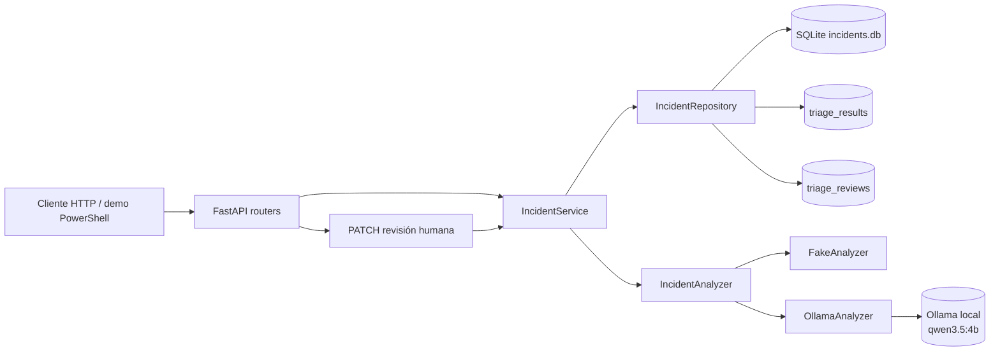

# Sistema inteligente de triaje de incidencias

API pequeña para registrar incidencias, generar una propuesta de triaje y permitir que una persona la acepte o la
corrija. El proyecto está pensado como MVP demostrable para portfolio y entrevista: mantiene separadas la entrada,
el análisis, la persistencia y la revisión humana, sin añadir todavía UI, autenticación, RAG ni agentes.

## Qué resuelve

1. Recibe una incidencia con contexto técnico.
2. La persiste en SQLite y la deja en estado `created`.
3. Ejecuta un analizador explícito con `POST /incidents/{id}/analysis`.
4. Guarda la propuesta estructurada (`category`, `severity`, `priority`, faltantes y confianza).
5. Permite aceptar o corregir la propuesta con `PATCH /incidents/{id}/triage`.
6. Conserva la propuesta original y almacena los valores finales revisados.

Estados principales: `created → analyzing → analyzed → reviewed`. Si el análisis falla, el estado es
`analysis_failed`.

## Arquitectura



Capas:

- `app/main.py`: rutas HTTP, dependencias y traducción de errores a códigos HTTP.
- `app/service.py`: transiciones de estado y casos de uso.
- `app/repository.py`: consultas y persistencia SQLAlchemy.
- `app/orm_models.py`: tablas `incidents`, `triage_results` y `triage_reviews`.
- `app/analyzer.py`: protocolo `IncidentAnalyzer`, `FakeAnalyzer` y adaptador `OllamaAnalyzer`.
- `app/schemas.py`: contratos Pydantic públicos.
- `app/evaluation.py`: evaluación offline independiente de FastAPI.

## Instalación y ejecución local

Requiere Python 3.11 o superior:

```powershell
python -m venv .venv
.\.venv\Scripts\Activate.ps1
python -m pip install -e ".[test]"
uvicorn app.main:app --reload
```

La API queda en `http://127.0.0.1:8000`; OpenAPI está disponible en `/docs`. SQLite usa por defecto una ruta
absoluta en la raíz del proyecto para no depender del directorio desde el que se arranque Uvicorn.

## Configuración

| Variable | Default | Uso |
|---|---|---|
| `APP_NAME` | nombre del proyecto | Título de FastAPI. |
| `DATABASE_URL` | SQLite local absoluta | URL SQLAlchemy; no se crean migraciones en este MVP. |
| `ANALYZER_BACKEND` | `fake` | `fake` para desarrollo/tests o `ollama` explícito. |
| `OLLAMA_BASE_URL` | `http://127.0.0.1:11434` | Runtime local de Ollama. |
| `OLLAMA_MODEL` | `qwen3.5:4b` | Modelo Ollama. |
| `OLLAMA_TIMEOUT_SECONDS` | `180` | Timeout finito del adaptador. |

El arranque valida backend, URL HTTP(S), modelo no vacío y timeout positivo. `GET /health` no llama a Ollama ni
expone URL, modelo o secretos:

```json
{"status":"ok","analyzer_backend":"fake"}
```

## API y ejemplos

### Crear incidencia — `POST /incidents`

```powershell
$body = '{"title":"El panel no carga","description":"Devuelve un error al abrirlo.","steps_to_reproduce":"Abrir el panel.","environment":"local","components":["frontend"]}'
curl.exe -i -X POST http://127.0.0.1:8000/incidents `
  -H "Content-Type: application/json" --data-raw $body
```

Respuesta `201 Created`:

```json
{
  "title": "El panel no carga",
  "description": "Devuelve un error al abrirlo.",
  "steps_to_reproduce": "Abrir el panel.",
  "expected_behavior": null,
  "actual_behavior": null,
  "environment": "local",
  "components": ["frontend"],
  "id": "00000000-0000-0000-0000-000000000000",
  "status": "created",
  "created_at": "2026-10-29T12:00:00",
  "triage": null
}
```

### Consultar — `GET /incidents/{incident_id}`

```powershell
curl.exe -i http://127.0.0.1:8000/incidents/{incident_id}
```

Devuelve `200` si existe y `404` con `{"detail":"Incident not found"}` si no existe.

### Analizar — `POST /incidents/{incident_id}/analysis`

```powershell
curl.exe -i -X POST http://127.0.0.1:8000/incidents/{incident_id}/analysis
```

La respuesta `200` contiene `status: "analyzed"` y `triage` con:
`category` (`bug`, `feature`, `documentation`, `configuration`, `performance`), `severity`
(`low`, `medium`, `high`, `critical`), `priority` (`low`, `medium`, `high`, `urgent`), `summary`,
`affected_components`, `missing_information`, `justification` y `confidence` (`low`, `medium`, `high`).
Un segundo análisis devuelve `409`.

### Revisar — `PATCH /incidents/{incident_id}/triage`

```powershell
curl.exe -i -X PATCH http://127.0.0.1:8000/incidents/{incident_id}/triage `
  -H "Content-Type: application/json" `
  --data-raw '{"severity":"critical","priority":"urgent","review_comment":"Impacto confirmado"}'
```

La respuesta `200` cambia el estado a `reviewed`. `triage` sigue siendo la propuesta original y
`triage.review.final` contiene los valores finales, con `reviewed: true`, `source: "human"`, comentario y timestamp.
Un comentario solo acepta la propuesta sin cambios. Una petición vacía, una incidencia sin análisis o una revisión
duplicada devuelve `422`/`409` según el caso.

Límites relevantes: título 1–200 caracteres, descripción 1–5000, comentarios 2000, componentes y listas de triaje
máximo 20 elementos. Los campos desconocidos se rechazan.

## FakeAnalyzer y Ollama

`FakeAnalyzer` es el backend por defecto: determinista, local y útil para comprobar plumbing y transiciones, no para
medir calidad semántica de un LLM. Ollama es opcional:

```powershell
irm https://ollama.com/install.ps1 | iex
ollama serve
ollama pull qwen3.5:4b
ollama list
Invoke-RestMethod http://127.0.0.1:11434/api/tags
$env:ANALYZER_BACKEND = "ollama"
uvicorn app.main:app --reload
```

`OllamaAnalyzer` solicita JSON estructurado con temperatura cero, `think: false` y `num_predict: 512`; valida la
respuesta contra `TriageResult`. Proveedor no disponible o respuesta inválida producen `502`; timeout produce `504`,
sin fallback silencioso ni trazas en la respuesta. Los tests nunca llaman a Ollama.

## Evaluación offline

`eval/data/incidents.json` contiene 8 incidencias etiquetadas. Ejecuta:

```powershell
python -m app.evaluation
```

La salida fake es una referencia reproducible, pero no se espera exactitud perfecta: el dataset representa etiquetas
manuales de negocio y `FakeAnalyzer` solo implementa reglas simples de baseline. Una ejecución reciente produce:

```json
{
  "total": 8,
  "valid_responses": 8,
  "category_accuracy": 0.75,
  "severity_accuracy": 0.375,
  "priority_accuracy": 0.0,
  "missing_information_accuracy": 0.875,
  "confidence_accuracy": 0.875,
  "errors": 0,
  "error_rate": 0.0,
  "latency_ms_total": 0.54,
  "latency_ms_average": 0.07
}
```

Un acierto exige igualdad exacta en enums y en la lista de `missing_information`; `summary` y `justification` no se
puntúan por similitud de texto libre. La ausencia o presencia de cada concepto de `missing_information` se compara
como lista exacta; en el caso 8 se esperan literalmente latencia observada, porcentaje de peticiones afectadas,
momento en que ocurre, identificador de correlación y logs o métricas disponibles. La métrica fake es un baseline de
reglas/plumbing, no una evaluación de calidad del LLM, por lo que sus fallos frente a estas etiquetas son conocidos
y deliberados. Para Ollama, con el runtime ya disponible:

```powershell
python -m app.evaluation --backend ollama
```

## Demo reproducible

Con la API arrancada en otra terminal:

```powershell
.\scripts\demo.ps1
```

El script ejecuta health → create → analysis → GET → review, no contiene secretos y solo usa `curl.exe` y herramientas
incluidas en PowerShell. También acepta una URL alternativa:

```powershell
.\scripts\demo.ps1 -BaseUrl "http://localhost:8000"
```

## Docker y CI

```powershell
docker build -t triaje-api .
docker run --rm -p 8000:8000 -v "${PWD}/data:/data" `
  -e DATABASE_URL=sqlite:////data/incidents.db triaje-api
```

La imagen no incluye `incidents.db`, tests, `.venv`, artefactos locales ni secretos. El contenedor no inicia Ollama:
debe ejecutarse aparte. GitHub Actions en `.github/workflows/ci.yml` instala el proyecto, ejecuta `python -m pytest -q`
y valida el Dockerfile. PostgreSQL no se incorpora todavía: SQLite cubre el MVP local y evita añadir operación,
driver y migraciones antes de necesitar despliegue multiinstancia.

## Decisiones, costes y seguridad

- **SQLite frente a PostgreSQL:** SQLite reduce fricción para el MVP; PostgreSQL será razonable cuando haya
  concurrencia, despliegue multiinstancia o necesidad de operaciones gestionadas.
- **Ollama frente a carga directa Python:** Ollama aísla runtime/modelo, hardware y ciclo de vida; cargar
  `transformers`/`torch` dentro de FastAPI añadiría peso y complejidad innecesarios.
- **FakeAnalyzer:** permite tests rápidos y reproducibles sin descargar modelos.
- **Sin RAG/agentes:** no son necesarios para clasificar el contrato actual y aumentarían superficie y coste.
- **Validación estructurada:** Pydantic rechaza respuestas incompletas; se evita puntuar o persistir texto no validado.
- **Revisión humana:** la tabla `triage_reviews` conserva el original y permite medir correcciones futuras.
- **Coste:** FakeAnalyzer + SQLite no requieren servicios externos; Ollama consume CPU/GPU, memoria, almacenamiento y
  tiempo local; se evitan costes de API externa en el MVP. El coste real depende del hardware y del modelo.
- **Seguridad:** no hay credenciales en el código; health y errores no exponen secretos; valida límites y configuración;
  usa una red local controlada para Ollama y no envíes datos sensibles sin una política de privacidad.

## Cómo explicarlo en entrevista

> “Separé el caso de uso de análisis del proveedor mediante `IncidentAnalyzer`: el fake da un baseline reproducible
> y Ollama es un adaptador opcional. La propuesta se persiste separada de la revisión humana, así puedo auditar qué
> sugirió el sistema y qué cambió la persona. Medí exactitud estructurada, faltantes, errores y latencia en un dataset
> pequeño; sé que el fake no mide calidad de LLM. Elegí SQLite para reducir el coste operativo del MVP, añadí límites,
> errores explícitos, logs JSON sin contenido sensible y CI/Docker para que la demo sea reproducible.” 

## Limitaciones y mejoras futuras

- Dataset pequeño y etiquetado manualmente; ampliar casos y separar conjuntos de desarrollo/evaluación.
- El FakeAnalyzer no reconoce todavía señales como severidad global, impacto por porcentaje, ventanas temporales,
  errores de correo, configuración de PostgreSQL o síntomas de latencia descritos con vocabulario no contemplado;
  no se ajustó para forzar una puntuación artificialmente perfecta.
- Añadir percentiles de latencia y métricas por clase cuando exista más volumen.
- Incorporar PostgreSQL y migraciones al requerir despliegue multiinstancia.
- Añadir autenticación, autorización, retención y auditoría de usuarios antes de producción.
- Añadir UI y revisión humana enriquecida después de estabilizar el contrato API.
