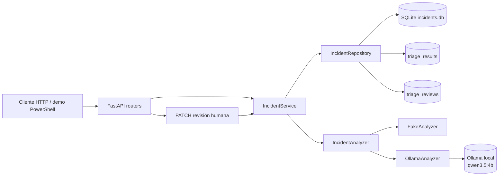

# Sistema inteligente de triaje de incidencias

API pequeña para registrar incidencias, generar una propuesta de triaje y permitir que una persona la acepte o la
corrija. El proyecto está pensado como MVP demostrable para portfolio y entrevista: mantiene separadas la entrada,
el análisis, la persistencia y la revisión humana, sin añadir todavía UI, autenticación, RAG ni agentes.

## Qué resuelve

1. Recibe una incidencia con contexto técnico.
2. La persiste en SQLite y la deja en estado `created`.
3. Ejecuta un analizador explícito con `POST /incidents/{id}/analysis`.
4. Guarda la propuesta estructurada (`category`, `severity`, `priority`, faltantes y confianza).
5. Permite aceptar o corregir la propuesta con `PATCH /incidents/{id}/triage`.
6. Conserva la propuesta original y almacena los valores finales revisados.

Estados principales: `created → analyzing → analyzed → reviewed`. Si el análisis falla, el estado es
`analysis_failed`.

## Arquitectura



Capas:

- `app/main.py`: rutas HTTP, dependencias y traducción de errores a códigos HTTP.
- `app/service.py`: transiciones de estado y casos de uso.
- `app/repository.py`: consultas y persistencia SQLAlchemy.
- `app/orm_models.py`: tablas `incidents`, `triage_results` y `triage_reviews`.
- `app/analyzer.py`: protocolo `IncidentAnalyzer`, `FakeAnalyzer` y adaptador `OllamaAnalyzer`.
- `app/schemas.py`: contratos Pydantic públicos.
- `app/evaluation.py`: evaluación offline independiente de FastAPI.

## Instalación y ejecución local

Requiere Python 3.11 o superior:

```powershell
python -m venv .venv
.\.venv\Scripts\Activate.ps1
python -m pip install -e ".[test]"
uvicorn app.main:app --reload
```

La API queda en `http://127.0.0.1:8000`; OpenAPI está disponible en `/docs`. SQLite usa por defecto una ruta
absoluta en la raíz del proyecto para no depender del directorio desde el que se arranque Uvicorn.

## Configuración

| Variable | Default | Uso |
|---|---|---|
| `APP_NAME` | nombre del proyecto | Título de FastAPI. |
| `DATABASE_URL` | SQLite local absoluta | URL SQLAlchemy; no se crean migraciones en este MVP. |
| `ANALYZER_BACKEND` | `fake` | `fake` para desarrollo/tests o `ollama` explícito. |
| `OLLAMA_BASE_URL` | `http://127.0.0.1:11434` | Runtime local de Ollama. |
| `OLLAMA_MODEL` | `qwen3.5:4b` | Modelo Ollama. |
| `OLLAMA_TIMEOUT_SECONDS` | `180` | Timeout finito del adaptador. |

El arranque valida backend, URL HTTP(S), modelo no vacío y timeout positivo. `GET /health` no llama a Ollama ni
expone URL, modelo o secretos:

```json
{"status":"ok","analyzer_backend":"fake"}
```

## API y ejemplos

### Crear incidencia — `POST /incidents`

```powershell
$body = '{"title":"El panel no carga","description":"Devuelve un error al abrirlo.","steps_to_reproduce":"Abrir el panel.","environment":"local","components":["frontend"]}'
curl.exe -i -X POST http://127.0.0.1:8000/incidents `
  -H "Content-Type: application/json" --data-raw $body
```

Respuesta `201 Created`:

```json
{
  "title": "El panel no carga",
  "description": "Devuelve un error al abrirlo.",
  "steps_to_reproduce": "Abrir el panel.",
  "expected_behavior": null,
  "actual_behavior": null,
  "environment": "local",
  "components": ["frontend"],
  "id": "00000000-0000-0000-0000-000000000000",
  "status": "created",
  "created_at": "2026-10-29T12:00:00",
  "triage": null
}
```

### Consultar — `GET /incidents/{incident_id}`

```powershell
curl.exe -i http://127.0.0.1:8000/incidents/{incident_id}
```

Devuelve `200` si existe y `404` con `{"detail":"Incident not found"}` si no existe.

### Analizar — `POST /incidents/{incident_id}/analysis`

```powershell
curl.exe -i -X POST http://127.0.0.1:8000/incidents/{incident_id}/analysis
```

La respuesta `200` contiene `status: "analyzed"` y `triage` con:
`category` (`bug`, `feature`, `documentation`, `configuration`, `performance`), `severity`
(`low`, `medium`, `high`, `critical`), `priority` (`low`, `medium`, `high`, `urgent`), `summary`,
`affected_components`, `missing_information`, `justification` y `confidence` (`low`, `medium`, `high`).
Un segundo análisis devuelve `409`.

### Revisar — `PATCH /incidents/{incident_id}/triage`

```powershell
curl.exe -i -X PATCH http://127.0.0.1:8000/incidents/{incident_id}/triage `
  -H "Content-Type: application/json" `
  --data-raw '{"severity":"critical","priority":"urgent","review_comment":"Impacto confirmado"}'
```

La respuesta `200` cambia el estado a `reviewed`. `triage` sigue siendo la propuesta original y
`triage.review.final` contiene los valores finales, con `reviewed: true`, `source: "human"`, comentario y timestamp.
Un comentario solo acepta la propuesta sin cambios. Una petición vacía, una incidencia sin análisis o una revisión
duplicada devuelve `422`/`409` según el caso.

Límites relevantes: título 1–200 caracteres, descripción 1–5000, comentarios 2000, componentes y listas de triaje
máximo 20 elementos. Los campos desconocidos se rechazan.

## FakeAnalyzer y Ollama

`FakeAnalyzer` es el backend por defecto: determinista, local y explicable. Normaliza mayúsculas y acentos, aplica
reglas con límites de palabra y puntúa señales de categoría, severidad y prioridad. También detecta conceptos que
faltan en el texto (latencia, porcentaje afectado, ventana temporal, correlación y observabilidad) cuando la
incidencia es ambigua. La justificación enumera las señales que han influido en la propuesta. Sigue siendo un
baseline de reglas, no una medida de calidad semántica de un LLM. Ollama es opcional:

```powershell
irm https://ollama.com/install.ps1 | iex
ollama serve
ollama pull qwen3.5:4b
ollama list
Invoke-RestMethod http://127.0.0.1:11434/api/tags
$env:ANALYZER_BACKEND = "ollama"
uvicorn app.main:app --reload
```

`OllamaAnalyzer` solicita JSON estructurado con temperatura cero, `think: false` y `num_predict: 512`; valida la
respuesta contra `TriageResult`. Proveedor no disponible o respuesta inválida producen `502`; timeout produce `504`,
sin fallback silencioso ni trazas en la respuesta. Los tests nunca llaman a Ollama.

## Evaluación offline

Hay varios conjuntos con propósitos distintos:

- `eval/data/incidents.json`: 28 casos de desarrollo, usados para ajustar las reglas.
- `eval/data/incidents-holdout.json`: 12 casos del primer holdout. Se usó para detectar el fallo de credenciales, así
  que después de corregirlo ya no es una referencia ciega.
- `eval/data/incidents-regression.json`: 12 casos que encontraron falsos positivos durante esta iteración (“documento”
  interpretado como documentación, guías que mencionan configuración). Se conserva como regresión.
- `eval/data/incidents-holdout-v2.json`: 12 casos escritos después de los cambios y ejecutados una sola vez. Es la
  referencia más honesta de generalización de esta iteración.

```powershell
python -m app.evaluation
python -m app.evaluation --dataset eval/data/incidents-holdout-v2.json
python -m app.evaluation --dataset eval/data/incidents-regression.json
python -m app.evaluation --dataset eval/data/incidents-holdout.json
python -m app.evaluation --verbose
python -m app.evaluation --summary
python -m app.evaluation --summary --dataset eval/data/incidents-holdout-v2.json
```

`--verbose` imprime en `stderr` el resultado por caso y los campos que no coinciden. `--summary` imprime en `stderr` un
resumen legible (accuracy, macro-F1, calibración de confianza, errores por categoría esperada y principales
confusiones). En ambos casos el JSON de métricas permanece en `stdout` para poder redirigirlo. La salida se fuerza a
UTF-8 para que los acentos no se corrompan al redirigir en Windows. Las métricas de calidad son reproducibles; solo
varía la latencia. Una ejecución reciente del baseline `FakeAnalyzer` produce:

| Conjunto | Casos | Category | Severity | Priority | Missing info | Confidence | Errores |
|---|---:|---:|---:|---:|---:|---:|---:|
| Desarrollo (ajuste) | 28 | 1.000 | 1.000 | 1.000 | 1.000 | 0.893 | 0 |
| Holdout original (ya no ciego) | 12 | 1.000 | 1.000 | 1.000 | 1.000 | 1.000 | 0 |
| Regresión | 12 | 1.000 | 0.917 | 1.000 | 1.000 | 1.000 | 0 |
| Holdout v2 (ciego) | 12 | 1.000 | 0.917 | 0.917 | 1.000 | 0.917 | 0 |

Además de la accuracy, el JSON incluye:

- `category_macro_f1`, `severity_macro_f1` y `priority_macro_f1`.
- `per_class`: precisión, recall, F1 y soporte por clase.
- `confusion_matrix`: matriz esperado × predicho por campo.
- `missing_information_precision`, `missing_information_recall` y `missing_information_f1` en micro.
- `latency_ms_p50` y `latency_ms_p95`.
- `confidence_calibration`: para cada nivel (`low`, `medium`, `high`), número de casos, casos totalmente correctos y
  accuracy. Sirve para comprobar si la confianza declarada se corresponde con los aciertos reales.
- `errors_by_category`: número de fallos agrupados por la categoría esperada, para localizar qué clases concentran el
  error.

En el holdout v2, la categoría acierta 12/12 y los dos fallos son ilustrativos: “no está disponible” no activa la
criticidad porque la regla solo reconoce “no disponible”, y un bug sin señal léxica clara queda en confianza `low`
frente a `medium`. No se ajustaron las reglas después de ver ese resultado. En desarrollo, la confianza `medium` acierta
2/2 y `high` 23/26; los tres desacuerdos son casos etiquetados como `medium` que el motor considera `high`.

Un acierto de enum exige igualdad exacta. `missing_information` se sigue comparando como lista exacta para la
accuracy, pero las métricas de precisión/recall/F1 permiten distinguir entre olvidar un concepto y añadir uno de más.
`summary` y `justification` no se puntúan por similitud de texto libre.

El 1.000 de desarrollo es optimista porque esas reglas se ajustaron con ese conjunto. Los holdouts tienen 12 casos: un
solo fallo mueve la accuracy unos 8 puntos, así que los resultados deben leerse como una señal de robustez del
baseline, no como una estimación precisa. Para Ollama, con el runtime ya disponible:

```powershell
python -m app.evaluation --backend ollama
```

## Demo reproducible

Con la API arrancada en otra terminal:

```powershell
.\scripts\demo.ps1
```

El script ejecuta health → create → analysis → GET → review, no contiene secretos y solo usa `curl.exe` y herramientas
incluidas en PowerShell. También acepta una URL alternativa:

```powershell
.\scripts\demo.ps1 -BaseUrl "http://localhost:8000"
```

## Docker y CI

```powershell
docker build -t triaje-api .
docker run --rm -p 8000:8000 -v "${PWD}/data:/data" `
  -e DATABASE_URL=sqlite:////data/incidents.db triaje-api
```

La imagen no incluye `incidents.db`, tests, `.venv`, artefactos locales ni secretos. El contenedor no inicia Ollama:
debe ejecutarse aparte. GitHub Actions en `.github/workflows/ci.yml` instala el proyecto, ejecuta `python -m pytest -q`
y valida el Dockerfile. PostgreSQL no se incorpora todavía: SQLite cubre el MVP local y evita añadir operación,
driver y migraciones antes de necesitar despliegue multiinstancia.

## Decisiones, costes y seguridad

- **SQLite frente a PostgreSQL:** SQLite reduce fricción para el MVP; PostgreSQL será razonable cuando haya
  concurrencia, despliegue multiinstancia o necesidad de operaciones gestionadas.
- **Ollama frente a carga directa Python:** Ollama aísla runtime/modelo, hardware y ciclo de vida; cargar
  `transformers`/`torch` dentro de FastAPI añadiría peso y complejidad innecesarios.
- **FakeAnalyzer:** permite tests rápidos y reproducibles sin descargar modelos.
- **Sin RAG/agentes:** no son necesarios para clasificar el contrato actual y aumentarían superficie y coste.
- **Validación estructurada:** Pydantic rechaza respuestas incompletas; se evita puntuar o persistir texto no validado.
- **Revisión humana:** la tabla `triage_reviews` conserva el original y permite medir correcciones futuras.
- **Coste:** FakeAnalyzer + SQLite no requieren servicios externos; Ollama consume CPU/GPU, memoria, almacenamiento y
  tiempo local; se evitan costes de API externa en el MVP. El coste real depende del hardware y del modelo.
- **Seguridad:** no hay credenciales en el código; health y errores no exponen secretos; valida límites y configuración;
  usa una red local controlada para Ollama y no envíes datos sensibles sin una política de privacidad.

## Cómo explicarlo en entrevista

> “Separé el caso de uso de análisis del proveedor mediante `IncidentAnalyzer`: el fake es un baseline determinista
> con normalización, reglas explicables y señales de impacto; Ollama es un adaptador opcional. La propuesta se persiste
> separada de la revisión humana, así puedo auditar qué sugirió el sistema y qué cambió la persona. Medí accuracy,
> macro-F1, precisión/recall de faltantes, matrices de confusión, calibración de confianza y percentiles de latencia en
> desarrollo, un holdout original, un conjunto de regresión y un holdout ciego escrito después de los cambios; sé que
> el fake no mide calidad de LLM y que 12 casos son una muestra pequeña. Elegí SQLite para reducir el coste operativo
> del MVP, añadí límites, errores explícitos, logs JSON sin contenido sensible y CI/Docker para que la demo sea
> reproducible.”

## Limitaciones y mejoras futuras

- Dataset pequeño y etiquetado manualmente; ampliar casos, revisar el acuerdo entre etiquetadores y añadir más
  ejemplos por clase antes de interpretar las métricas como una estimación estable.
- El `FakeAnalyzer` sigue siendo un motor de reglas, no comprensión semántica. Se corrigieron los fallos de seguridad
  indirecta (“datos de otra cuenta”), sinónimos como “va más despacio”, elementos de UI que “no aparecen” y
  credenciales que también contienen `error`/`falla`. Quedan variantes literales (“no está disponible” frente a “no
  disponible”), giros como “pierde cambios” sin “se”, documentación que menciona configuración y la confianza en bugs
  sin señal léxica clara. El caso CORS del conjunto de regresión sigue etiquetado como `medium` y el motor lo marca
  como `high`: es una ambigüedad de política, no un fallo evidente. No se ajustó para forzar una puntuación
  artificialmente perfecta.
- `missing_information` se puntúa con listas exactas además de micro-F1; con pocos casos positivos, una métrica de 1.0
  no debe interpretarse como calidad de producción.
- Añadir análisis de errores por clase y calibración de confianza con más volumen: ya existen ambos en el JSON y en
  `--summary`, pero con 64 casos repartidos en varios conjuntos siguen siendo señales, no estimaciones estables.
- Incorporar PostgreSQL y migraciones al requerir despliegue multiinstancia.
- Añadir autenticación, autorización, retención y auditoría de usuarios antes de producción.
- Añadir UI y revisión humana enriquecida después de estabilizar el contrato API.
