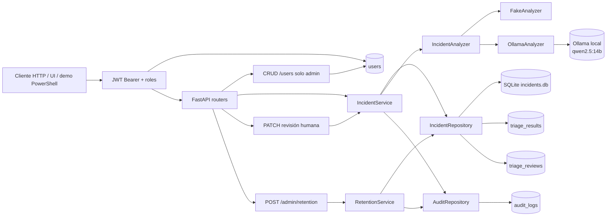

# Arquitectura

Este documento describe cómo está organizado el sistema, qué responsabilidad tiene cada capa y cuál es el flujo de una
incidencia. Para el entorno de desarrollo, la configuración y los comandos, consulta
[development.md](development.md); para los datos y las métricas de calidad, [evaluation.md](evaluation.md).

## Flujo general

1. Recibe una incidencia con contexto técnico.
2. La persiste en SQLite y la deja en estado `created`.
3. Ejecuta un analizador explícito con `POST /incidents/{id}/analysis`.
4. Guarda la propuesta estructurada (`category`, `severity`, `priority`, faltantes y confianza).
5. Permite aceptar o corregir la propuesta con `PATCH /incidents/{id}/triage`, dejando checklist y comentario.
6. Conserva la propuesta original y almacena los valores finales revisados.
7. Protege la API con JWT y roles `reader`, `writer` y `admin`; la UI oculta las acciones no permitidas.
8. Gestiona usuarios y roles desde la API y la UI, con guardas para no quedarse sin administradores.
9. Registra las acciones relevantes en una auditoría consultable sin contenido sensible.
10. Purga incidencias y auditoría antiguas con dry-run, ejecución administrativa y traza del resultado.

Estados principales: `created → analyzing → analyzed → reviewed`. Si el análisis falla, el estado es
`analysis_failed`.

## Diagrama



## Capas

- `backend/main.py`: creación de la aplicación y ciclo de vida; las rutas y dependencias están en `backend/api/`.
- `backend/api/routes.py`: controladores HTTP, validación mediante esquemas y traducción de errores a HTTP.
- `backend/api/dependencies.py`: composición de servicios, repositorios y analizadores para FastAPI.
- `backend/security/auth.py`: roles, Argon2id, emisión/validación de JWT y dependencias de autenticación/autorización.
- `backend/services/incident.py`: transiciones de estado y casos de uso de incidencias.
- `backend/services/users.py`: bootstrap, login, CRUD de usuarios y guardas del último administrador.
- `backend/services/retention.py`: caso de uso de retención y CLI `python -m backend.services.retention`.
- `backend/infrastructure/repositories.py`: consultas y persistencia SQLAlchemy, incluida auditoría, usuarios y retención.
- `backend/infrastructure/orm_models.py`: tablas `users`, `incidents`, `triage_results`, `triage_reviews` y `audit_logs`.
- `backend/infrastructure/config.py` y `backend/infrastructure/database.py`: configuración, engine, sesiones, creación de
  tablas y migración aditiva ligera.
- `backend/domain/models.py`: enums y estados del dominio.
- `backend/analyzers/core.py`: protocolo `IncidentAnalyzer`, `FakeAnalyzer` y adaptador `OllamaAnalyzer`.
- `backend/api/schemas.py`: contratos Pydantic públicos.
- `evaluation/runner.py`: evaluación offline independiente de FastAPI.

La aplicación usa estas rutas por capas directamente; no se mantienen módulos fachada ni aliases de compatibilidad.

## Autenticación y autorización

La fuente de verdad es la tabla `users`: usuario, rol, `active`, hash Argon2id y versión de token. `AUTH_USERS` solo
siembra usuarios que aún no existan al arrancar; no actualiza contraseñas, roles ni reactiva cuentas. Una vez creada
la tabla, los cambios se hacen con el CRUD administrativo o directamente en base de datos.

```powershell
$env:AUTH_USERS = "soporte:writer:contraseña-de-soporte,auditor:reader:contraseña-de-auditor,admin:admin:contraseña-de-admin"
$env:JWT_SECRET = "cambia-este-secreto-por-uno-de-al-menos-32-caracteres"
uvicorn backend.main:app --reload
```

- `POST /auth/login` recibe `{"username":"soporte","password":"..."}` y devuelve el par de tokens (`access_token` de 15
  min y `refresh_token` de 7 días con rotación) más el usuario.
- `POST /auth/refresh` recibe `{"refresh_token":"..."}`, valida la sesión en BD y emite un nuevo par de tokens
  (`access_token` renovado y `refresh_token` rotado).
- `GET /auth/me` devuelve `name`, `role` y `authenticated`. La UI lo usa para decidir qué acciones mostrar.
- `POST /auth/logout` revoca los tokens del usuario autenticado y responde `204`. La UI lo llama al pulsar **Salir** y,
  pase lo que pase, borra después los tokens locales.
- Las contraseñas se guardan con **Argon2id** y salt único; nunca se devuelven, registran ni auditan.
- El JWT de acceso incluye `sub`, `role`, `ver`, `typ: "access"`, `iat` y `exp`. `ver` es la versión de token del
  usuario.
- El refresh token incluye `sub`, `ver`, `typ: "refresh"`, `iat` y `exp` (no se puede usar directamente como token de
  autorización Bearer en endpoints de negocio).
- Cambiar la contraseña incrementa `token_version`: tanto el access token como el refresh token dejan de valer de
  inmediato.
- El logout también incrementa `token_version`, de modo que invalida **todos** los JWT y refresh tokens abiertos de ese
  usuario, no solo el token usado para cerrar sesión. Es una decisión consciente para que un token robado no siga vivo
  hasta su `exp`.
- Desactivar un usuario o cambiar su rol también se refleja de inmediato: cada petición y cada refresco revalida contra
  la BD.
- La UI implementa interceptores transparentes: cuando el `access_token` expira durante el uso de la aplicación,
  solicita automáticamente un nuevo par mediante `POST /auth/refresh` sin interrumpir al usuario; si el `refresh_token`
  también expiró o fue revocado, limpia el almacenamiento y redirige a `/login`.
- Los roles son jerárquicos: `reader < writer < admin`.
- Sin token o con token inválido la API devuelve `401`; con rol insuficiente, `403`.
- `GET /health` permanece público para sondas de disponibilidad.
- Si no hay `AUTH_USERS` ni filas en `users`, la API es fail-closed y los endpoints protegidos devuelven `401`. El
  acceso anónimo con rol `admin` solo se habilita de forma explícita con `ALLOW_ANONYMOUS_BOOTSTRAP=true`, pensado para
  demos locales; el arranque registra un aviso. Si `AUTH_USERS` está configurado, la auth se exige aunque la tabla esté
  vacía.

| Rol | Permisos |
|---|---|
| `reader` | `GET /incidents`, `GET /incidents/{id}`, `GET /review-metrics`, `GET /auth/me` y `POST /auth/logout` |
| `writer` | Todo lo de `reader` más `POST /incidents`, `POST /incidents/{id}/analysis` y `PATCH /incidents/{id}/triage` |
| `admin` | Todo lo anterior más `GET /audit`, `POST /admin/retention` y el CRUD de `/users` |

```powershell
$login = curl.exe -sS -X POST http://127.0.0.1:8000/auth/login `
  -H "Content-Type: application/json" `
  --data-raw '{"username":"auditor","password":"contraseña-de-auditor"}' | ConvertFrom-Json
curl.exe -i http://127.0.0.1:8000/incidents/{incident_id} `
  -H "Authorization: Bearer $($login.access_token)"
curl.exe -i http://127.0.0.1:8000/auth/me `
  -H "Authorization: Bearer $($login.access_token)"
curl.exe -i -X POST http://127.0.0.1:8000/auth/logout `
  -H "Authorization: Bearer $($login.access_token)"
```

Guardas del CRUD de usuarios:

- Solo `admin` puede listar, crear, consultar, actualizar o desactivar usuarios.
- No se puede desactivar el último administrador activo ni degradar su rol.
- Un administrador no puede desactivar su propio usuario.
- El borrado es lógico (`DELETE` desactiva), para conservar la trazabilidad de la auditoría.
- Los nombres admiten `A-Z`, `a-z`, `0-9`, `.`, `_` y `-`; las contraseñas tienen entre 12 y 200 caracteres.

## API

| Método | Ruta | Uso |
|---|---|---|
| `GET` | `/health` | Health check público. |
| `POST` | `/auth/login` | Obtener el par de tokens. |
| `POST` | `/auth/refresh` | Rotar el par de tokens. |
| `GET` | `/auth/me` | Identidad y rol del usuario autenticado. |
| `POST` | `/auth/logout` | Revocar los tokens del usuario. |
| `POST` | `/incidents` | Crear una incidencia. |
| `GET` | `/incidents` | Bandeja paginada y filtrable. |
| `GET` | `/incidents/{incident_id}` | Consultar una incidencia. |
| `POST` | `/incidents/{incident_id}/analysis` | Ejecutar el analizador. |
| `PATCH` | `/incidents/{incident_id}/triage` | Aceptar o corregir el triaje. |
| `GET` | `/review-metrics` | Métricas de revisión humana. |
| `GET` | `/audit` | Consultar la auditoría (solo `admin`). |
| `POST` | `/admin/retention` | Ejecutar retención (solo `admin`). |
| `GET` | `/users` | Listar usuarios (solo `admin`). |
| `POST` | `/users` | Crear usuario (solo `admin`). |
| `GET` | `/users/{user_id}` | Consultar usuario (solo `admin`). |
| `PATCH` | `/users/{user_id}` | Actualizar usuario (solo `admin`). |
| `DELETE` | `/users/{user_id}` | Desactivar usuario (solo `admin`). |

### Health — `GET /health`

Es público, no llama a Ollama ni expone URL, modelo, usuarios, claves o secretos:

```json
{"status":"ok","analyzer_backend":"fake"}
```

### Crear incidencia — `POST /incidents`

```powershell
$body = '{"title":"El panel no carga","description":"Devuelve un error al abrirlo.","steps_to_reproduce":"Abrir el panel.","environment":"local","components":["frontend"]}'
curl.exe -i -X POST http://127.0.0.1:8000/incidents `
  -H "Content-Type: application/json" --data-raw $body
```

Respuesta `201 Created`:

```json
{
  "title": "El panel no carga",
  "description": "Devuelve un error al abrirlo.",
  "steps_to_reproduce": "Abrir el panel.",
  "expected_behavior": null,
  "actual_behavior": null,
  "environment": "local",
  "components": ["frontend"],
  "id": "00000000-0000-0000-0000-000000000000",
  "status": "created",
  "created_at": "2026-10-29T12:00:00",
  "triage": null
}
```

### Consultar — `GET /incidents/{incident_id}`

```powershell
curl.exe -i http://127.0.0.1:8000/incidents/{incident_id}
```

Devuelve `200` si existe y `404` con `{"detail":"Incident not found"}` si no existe.

### Bandeja ligera — `GET /incidents`

```powershell
curl.exe -i "http://127.0.0.1:8000/incidents?limit=20&offset=0&status=analyzed&confidence=high"
```

Devuelve incidencias ordenadas por `created_at` descendente con `id`, `title`, `status`, `created_at`, la `confidence`
de la propuesta y los bloques ligeros `proposal` y `final` (este último solo si existe una revisión). Admite `limit`
(1–200), `offset`, `status`, `confidence` y `sort`. Con `sort=confidence` ordena de confianza baja a alta (los `null` al
final y, dentro de cada grupo, por fecha descendente), lo que permite construir la vista de pendientes priorizando lo
que más necesita revisión humana.

### Analizar — `POST /incidents/{incident_id}/analysis`

```powershell
curl.exe -i -X POST http://127.0.0.1:8000/incidents/{incident_id}/analysis
```

La respuesta `200` contiene `status: "analyzed"` y `triage` con: `category` (`bug`, `feature`, `documentation`,
`configuration`, `performance`), `severity` (`low`, `medium`, `high`, `critical`), `priority` (`low`, `medium`, `high`,
`urgent`), `summary`, `affected_components`, `missing_information`, `justification` y `confidence` (`low`, `medium`,
`high`). Un segundo análisis desde `analyzed` devuelve `409`; si el estado es `analysis_failed`, se permite reintentar.

La transición a `analyzing` es un `UPDATE` condicional atómico: si dos peticiones compiten, solo una reclama la
incidencia y la otra recibe `409`. El triaje y el estado `analyzed` se guardan en la misma transacción. Si ya existía un
triaje de un intento anterior, se actualiza en lugar de violar el `unique`, de modo que un fallo entre ambas escrituras
no deja la incidencia atascada. El fallo solo se marca si el análisis sigue en curso.

### Revisar — `PATCH /incidents/{incident_id}/triage`

```powershell
curl.exe -i -X PATCH http://127.0.0.1:8000/incidents/{incident_id}/triage `
  -H "Content-Type: application/json" `
  --data-raw '{"severity":"critical","priority":"urgent","review_comment":"Impacto confirmado","review_checklist":["Revisé severidad y prioridad"]}'
```

La respuesta `200` cambia el estado a `reviewed`. `triage` sigue siendo la propuesta original y `triage.review.final`
contiene los valores finales, con `reviewed: true`, `source: "human"`, comentario, `review_checklist`, timestamp y los
campos corregidos. Un comentario solo acepta la propuesta sin cambios. Una petición vacía, una incidencia sin análisis
o una revisión duplicada devuelve `422`/`409` según el caso. Solo se revisa desde `analyzed`: la transición a `reviewed`
y la inserción de la revisión comparten transacción, por lo que dos revisiones concurrentes no pueden persistir ambas.
La checklist acepta hasta 20 elementos de 1–200 caracteres y se persiste en `triage_reviews.review_checklist`.

Límites relevantes: título 1–200 caracteres, descripción 1–5000, comentarios 2000, componentes y listas de triaje
máximo 20 elementos, y cada elemento 1–200 caracteres. Los campos desconocidos se rechazan. Si la autenticación está
activa, añade la cabecera `Authorization: Bearer <token>` a todas las peticiones salvo `GET /health`.

`affected_components` y `missing_information` se tratan como conjuntos: el orden de sus elementos no forma parte del
contrato y los duplicados se eliminan durante la validación. `summary` y `justification` se conservan como texto
exacto.

### Usuarios — `GET/POST/PATCH/DELETE /users`

Solo `admin`. Listado paginado en `GET /users?limit=50&offset=0`; creación con `POST /users`; consulta y actualización
con `GET/PATCH /users/{user_id}`; desactivación con `DELETE /users/{user_id}`.

```powershell
curl.exe -i -X POST http://127.0.0.1:8000/users `
  -H "Content-Type: application/json" `
  -H "Authorization: Bearer $($login.access_token)" `
  --data-raw '{"username":"nuevo.soporte","password":"contraseña-inicial-0123456789","role":"writer"}'
```

La respuesta nunca incluye `password_hash`. `PATCH` acepta `password`, `role` y `active`; debe cambiar al menos un
campo. `DELETE` desactiva al usuario en lugar de borrarlo. Los intentos de dejar el sistema sin administrador activo
devuelven `409`.

### Métricas de revisión — `GET /review-metrics`

```powershell
curl.exe -i http://127.0.0.1:8000/review-metrics
```

Devuelve el total de revisiones, aceptaciones sin cambios, acierto por campo, matrices de confusión para `category`,
`severity`, `priority` y `confidence`, y correcciones agrupadas por la confianza de la propuesta.

## Auditoría

Las acciones relevantes se guardan en la tabla `audit_logs` con actor, rol, acción, tipo e identificador del recurso y
metadatos operativos. No se guardan títulos, descripciones, comentarios, prompts ni claves.

| Acción | Cuándo se registra |
|---|---|
| `incident.create` | Se crea una incidencia. |
| `incident.analyze` | El análisis termina correctamente. |
| `incident.analysis_failed` | El análisis falla; incluye el tipo de error, no su mensaje. |
| `incident.review` | Se acepta o corrige el triaje; incluye campos realmente cambiados, si hubo comentario y nº de ítems de checklist. |
| `user.bootstrap` | Se siembran usuarios iniciales desde `AUTH_USERS`; incluye cuántos y con qué roles. |
| `user.create` | Un admin crea un usuario; incluye el rol, nunca la contraseña. |
| `user.update` | Un admin cambia contraseña, rol o estado; incluye `changed_fields` sin secretos. |
| `retention.run` | Se ejecuta un dry-run o una purga; incluye cortes y recuentos. |

`GET /audit` es solo para `admin` y admite `limit` (1–200, default 50), `offset`, `action`, `actor`, `resource_type` y
`resource_id`:

```powershell
curl.exe -i "http://127.0.0.1:8000/audit?action=incident.review&limit=20" `
  -H "Authorization: Bearer $($login.access_token)"
```

```json
{
  "items": [
    {
      "id": "00000000-0000-0000-0000-000000000000",
      "created_at": "2026-10-31T12:00:00+00:00",
      "actor": "soporte",
      "role": "writer",
      "action": "incident.review",
      "resource_type": "incident",
      "resource_id": "00000000-0000-0000-0000-000000000001",
      "details": {"status": "reviewed", "changed_fields": ["severity"], "has_comment": true, "checklist_items": 1}
    }
  ],
  "total": 1,
  "limit": 20,
  "offset": 0
}
```

## Retención de datos

La retención elimina datos antiguos por antigüedad, nunca por estado ni por contenido:

- `RETENTION_DAYS` define el corte de incidencias. Se borran primero sus `triage_reviews`, después sus `triage_results`
  y por último las incidencias. El cutoff se calcula con UTC.
- `AUDIT_RETENTION_DAYS` define el corte de `audit_logs`.
- Tanto la CLI como el endpoint hacen **dry-run por defecto**: calculan cuántas filas coinciden sin borrar nada.
- Cada ejecución, incluido el dry-run, se registra en auditoría como `retention.run`.

`POST /admin/retention` es solo para `admin` y acepta días alternativos para una ejecución concreta:

```powershell
curl.exe -i -X POST http://127.0.0.1:8000/admin/retention `
  -H "Authorization: Bearer $($login.access_token)" `
  -H "Content-Type: application/json" `
  --data-raw '{"dry_run":true,"incidents_days":90,"audit_days":365}'
```

```json
{
  "dry_run": true,
  "incident_cutoff": "2026-08-02T12:00:00+00:00",
  "audit_cutoff": "2025-10-31T12:00:00+00:00",
  "incidents_matched": 3,
  "triage_results_matched": 3,
  "triage_reviews_matched": 2,
  "audit_logs_matched": 10
}
```

Para ejecutarla fuera de la API:

```powershell
python -m backend.services.retention
python -m backend.services.retention --incidents-days 30 --audit-days 180
python -m backend.services.retention --apply
```

`*_matched` indica las filas seleccionadas por el corte; con `--apply` o `"dry_run": false` son las filas eliminadas.
La CLI imprime el resultado en JSON y usa el actor `retention-cli` con rol `admin`.

## Analizadores: FakeAnalyzer y Ollama

`FakeAnalyzer` es el backend por defecto: determinista, local y explicable. Normaliza mayúsculas y acentos, aplica
reglas con límites de palabra y puntúa señales de categoría, severidad y prioridad. También detecta conceptos que
faltan en el texto (latencia, porcentaje afectado, ventana temporal, correlación y observabilidad) cuando la incidencia
es ambigua. La justificación enumera las señales que han influido en la propuesta. Sigue siendo un baseline de reglas,
no una medida de calidad semántica de un LLM. Ollama es opcional:

```powershell
irm https://ollama.com/install.ps1 | iex
ollama serve
ollama pull qwen2.5:14b
ollama list
Invoke-RestMethod http://127.0.0.1:11434/api/tags
$env:ANALYZER_BACKEND = "ollama"
$env:OLLAMA_MODEL = "qwen2.5:14b"
uvicorn backend.main:app --reload
```

`OllamaAnalyzer` solicita JSON estructurado con temperatura cero, `think: false` y `num_predict: 512`; valida la
respuesta contra `TriageResult`. Proveedor no disponible o respuesta inválida producen `502`; timeout produce `504`,
sin fallback silencioso ni trazas en la respuesta. Los tests nunca llaman a Ollama.

## Despliegue

El modelo de despliegue es una única imagen Docker:

- Un stage de Node compila el frontend con Vite (`frontend/dist`).
- El stage final de Python instala el backend y copia ese build.
- Uvicorn expone la API y los estáticos en el mismo origen; `/docs`, `/openapi.json` y las rutas de API tienen
  prioridad sobre el fallback del SPA.
- El fallback devuelve `index.html` para rutas como `/metrics` o `/incidents/{id}`, de modo que `BrowserRouter`
  funcione al refrescar o entrar directamente.
- SQLite se persiste en un volumen (`/data/incidents.db`).

Al ser same-origin, el despliegue no necesita CORS. La imagen no incluye Ollama ni el archivo `incidents.db`. Los
comandos de build, ejecución y variables están en [development.md](development.md#docker).

## Decisiones, costes y seguridad

- **SQLite frente a PostgreSQL:** SQLite reduce fricción para el MVP; PostgreSQL será razonable cuando haya
  concurrencia, despliegue multiinstancia o necesidad de operaciones gestionadas. El engine activa
  `PRAGMA foreign_keys=ON` en cada conexión SQLite, de modo que las claves foráneas declaradas se aplican.
- **Ollama frente a carga directa Python:** Ollama aísla runtime/modelo, hardware y ciclo de vida; cargar
  `transformers`/`torch` dentro de FastAPI añadiría peso y complejidad innecesarios.
- **FakeAnalyzer:** permite tests rápidos y reproducibles sin descargar modelos.
- **Sin RAG/agentes:** no son necesarios para clasificar el contrato actual y aumentarían superficie y coste.
- **Validación estructurada:** Pydantic rechaza respuestas incompletas; se evita puntuar o persistir texto no validado.
- **Revisión humana:** la tabla `triage_reviews` conserva el original, la checklist y el comentario, y permite medir
  correcciones futuras.
- **Autenticación y autorización:** `users` es la fuente de verdad; `AUTH_USERS` solo siembra usuarios iniciales. Las
  contraseñas usan Argon2id con salt único y nunca se devuelven, registran ni auditan. Los JWT incluyen `ver`, expiran y
  se revalidan contra la BD en cada petición, por lo que cambiar contraseña o desactivar una cuenta revoca el acceso.
  Los roles son jerárquicos, el CRUD de usuarios es solo para `admin` y hay guardas para no quedarse sin administrador
  activo. El login limita los intentos fallidos por usuario e IP dentro de una ventana fija y responde `429` con
  `Retry-After`; el contador es por proceso y se reinicia con un login correcto. Sin `AUTH_USERS` ni usuarios la API
  responde `401` (fail-closed); el bootstrap anónimo es opt-in.
- **UI por rol:** el frontend consulta `/auth/me`; `reader` no ve acciones de escritura y solo `admin` ve Usuarios. El
  detalle muestra un diff IA→humano con los campos modificados y la checklist persistida.
- **Auditoría:** `audit_logs` registra actor, rol, acción, recurso y metadatos operativos. Se evita guardar texto libre
  de incidencias, comentarios, prompts o claves. La escritura es best-effort y no comparte transacción con la operación:
  si falla, la operación ya confirmada no se revierte y el fallo de auditoría se registra en el log. No es un sumidero
  inmutable externo.
- **Retención:** los cortes se calculan en UTC, la purga es explícita, auditable y hace dry-run por defecto; no se
  borra por estado ni por contenido. La API y la CLI comparten el mismo servicio.
- **Coste:** FakeAnalyzer + SQLite no requieren servicios externos; Ollama consume CPU/GPU, memoria, almacenamiento y
  tiempo local; se evitan costes de API externa en el MVP. El coste real depende del hardware y del modelo.
- **Seguridad:** no hay credenciales en el código; health y errores no exponen secretos; valida límites y
  configuración; usa una red local controlada para Ollama y no envíes datos sensibles sin una política de privacidad.

## Cómo explicarlo en entrevista

> “Separé el caso de uso de análisis del proveedor mediante `IncidentAnalyzer`: el fake es un baseline determinista
> con normalización, reglas explicables y señales de impacto; Ollama es un adaptador opcional. La propuesta se persiste
> separada de la revisión humana, así puedo auditar qué sugirió el sistema y qué cambió la persona. Medí accuracy,
> macro-F1, precisión/recall de faltantes, matrices de confusión, calibración de confianza y percentiles de latencia en
> desarrollo, un holdout original, un conjunto de regresión y un holdout escrito después de los cambios; además
> puedo comparar fake frente a Ollama con deltas por caso, métrica y latencia. Sé que el fake no mide calidad de LLM y
> que 12 casos son una muestra pequeña. Elegí SQLite para reducir el coste operativo del MVP, añadí límites, errores
> explícitos, logs JSON sin contenido sensible, usuarios persistidos con Argon2id, JWT versionados con roles
> jerárquicos, CRUD de usuarios con guardas de administrador, auditoría sin datos sensibles, retención con dry-run y
> CI/Docker para que la demo sea reproducible.”

Los detalles de las métricas, los conjuntos y la comparación están en [evaluation.md](evaluation.md).

## Limitaciones y mejoras futuras

Las limitaciones de calidad del análisis y de los conjuntos de evaluación están en
[evaluation.md](evaluation.md#limitaciones-de-la-evaluación).

- **Persistencia y operación:** SQLite y `create_all` simplifican el MVP local, pero un despliegue multiinstancia
  necesitará PostgreSQL, migraciones versionadas, copias de seguridad verificadas, restauración probada y una
  estrategia para concurrencia y observabilidad. La auditoría comparte la misma base de datos y no es un sumidero
  inmutable externo.
- **Autenticación y exposición de la API:** ya existe CRUD de usuarios, Argon2id, revocación por `token_version` y un
  limitador de intentos fallidos de login por usuario e IP (`LOGIN_MAX_ATTEMPTS` / `LOGIN_WINDOW_SECONDS`). Ese
  limitador vive en memoria y solo protege un proceso; con varios workers o instancias hace falta un almacén compartido
  o aplicarlo en el proxy. Faltan bloqueo de cuenta, MFA, rotación de `JWT_SECRET`, recuperación de contraseña,
  gestión centralizada de secretos, TLS en un proxy y una política de sesiones más completa. La autenticación
  deshabilitada por defecto debe mantenerse limitada a desarrollo local y tests. La migración de columnas aditivas es
  deliberadamente ligera: un despliegue real necesita migraciones versionadas.
- **Retención y cumplimiento:** la purga hace borrado físico, ejecuta dry-run por defecto y debe programarse fuera de la
  API. Todavía no cubre copias de seguridad, bloqueos legales, periodos de gracia, restauración selectiva ni una
  política de clasificación y minimización de datos más amplia.
- **Producto y observabilidad:** ya existe una UI inicial para bandeja, creación, detalle, revisión y métricas, pero
  faltan flujos más completos de búsqueda, filtros avanzados, paginación, gestión de errores y accesibilidad. También
  sería conveniente añadir métricas y trazas operativas sobre latencia, errores, uso de backends y tasa de
  correcciones, sin registrar contenido sensible.
- **Escalabilidad funcional:** RAG, agentes y automatizaciones no son necesarios para el contrato actual y aumentarían
  el coste y la superficie de fallo. Solo deberían incorporarse después de estabilizar el contrato API, demostrar una
  necesidad concreta y definir controles de privacidad, evaluación y revisión humana.
